# How a frame is drawn (26.3)

The order in which the game draws a frame, and which core program draws what. Use it to pick the file to replace.

The order comes from the 26.3 client code. The screenshots come from [tools/gallery.py](../tools/gallery.py): for each program, a pack makes the vanilla program output magenta (keeping its code, so discards still apply), and the game is filmed on a test scene. Vulkan, default settings, so "Improved Transparency" is off.

*The test scene, without any pack.*

## Frame order

1. **Clear** the main target to the fog color, and its depth to 0. *(code)*
2. **Sky**: sky color, sunrise and sunset glow, sun, moon and stars. In the End, the End sky. Skipped in lava, powder snow, and under effects that hide the sky. *(code)*
3. **Opaque**: opaque and cutout terrain (`core/terrain`), then solid "features": entities, block entities, items, particles… *(code)*
4. **Translucent.** It depends on the **Improved Transparency** option, off by default. *(code)*
   - **Off:** translucent features, translucent terrain, clouds, weather, then the world border, drawn back to front into the main target.
   - **On (OIT):** the same things go through three passes (depth bounds, transmittance, accumulate). That is what the `OIT_*` defines and the `oit_*` pipelines are. `core/oit_composite` then merges the result into the main target.
5. **Glowing outlines**: entities with Glowing are drawn into a separate `minecraft:entity_outline` target. The `minecraft:entity_outline` post effect blurs it. *(code)*
6. **See-through** features, such as name tags behind walls, then **always-on-top** debug shapes. *(code)*
7. **3D HUD**: the hand and held item, then screen overlays (fire, the block you are inside of), with their own depth. *(code)*
8. **Outline blit**: the glowing outline is composited onto the world with `core/blit_screen`. *(code)*
9. **Post effects**: `end_of_frame`, then `/posteffect`, then the spectated mob's (see [Post effects](post-effects.md)). They apply to everything above, **including the hand**. *(code)*
10. **GUI**: HUD, chat, menus, in a separate pass after the depth is cleared. Post effects never touch it. *(code)*

Two consequences worth knowing:
- **The hand's depth is not in the main depth when a post effect is active.** The hand draws into its own depth buffer then, so a post effect that reads depth does not see the hand. *(code)*
- **Without a post effect**, the hand uses the main depth after clearing it. *(code)*

## What each program draws

Magenta shows what the program drew in the test scene. Each image links to the version with the HUD shown. Programs not listed never draw into the world view: texture animation, the lightmap, depth copies, OIT bookkeeping and the title-screen panorama.

| Program | Draws (in this scene) | Pipelines that use it | |
|---|---|---|---|
| `terrain` | All chunk geometry: ground, water, glass, leaves, fences, **signs**, beacon block | `solid_terrain`, `cutout_terrain`, `translucent_terrain`… | [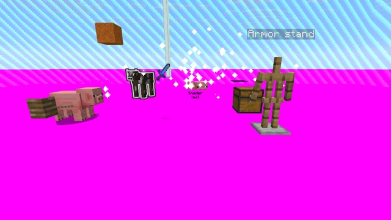](images/programs/terrain-hud.jpg) |
| `entity` | Mobs, armor stands, **chests** (block entities) | 37 pipelines: `entity_*`, `armor_*`, `banner_pattern`, `eyes`, `energy_swirl`… | [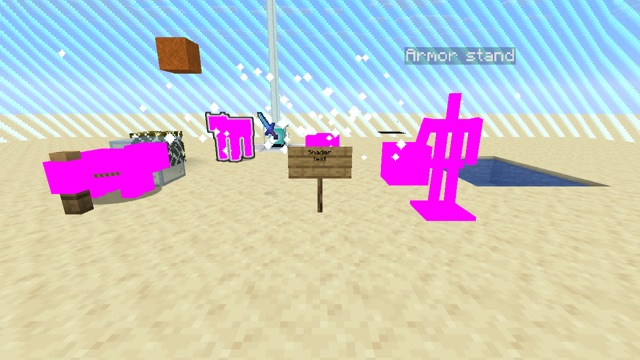](images/programs/entity-hud.jpg) |
| `item` | Dropped items, the held item, items in the hotbar and toasts | `item_cutout`, `item_translucent`, `item_translucent_glint` | [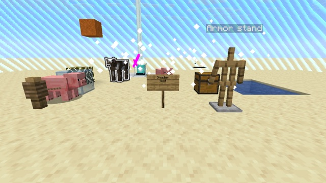](images/programs/item-hud.jpg) |
| `block` | Blocks drawn outside chunks: falling blocks, blocks moved by pistons | `solid_block`, `cutout_block`, `translucent_block` | [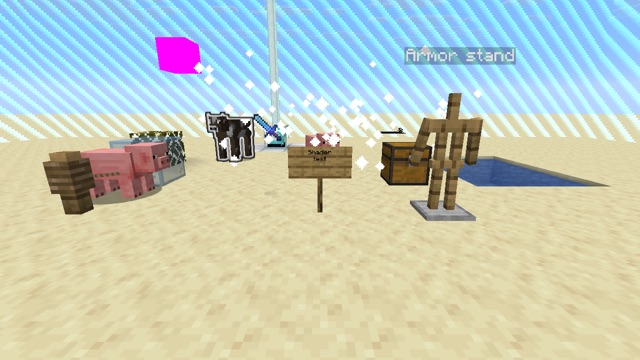](images/programs/block-hud.jpg) |
| `particle` | Particles; also rain and snow | `opaque_particle`, `translucent_particle`, `weather` | [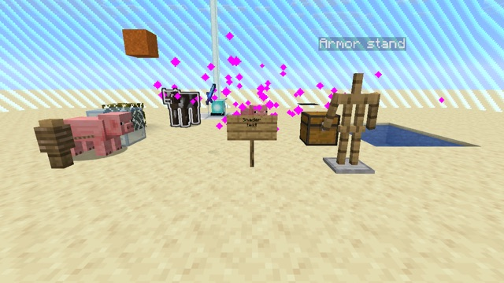](images/programs/particle-hud.jpg) |
| `sky` | The upper sky | `sky` | [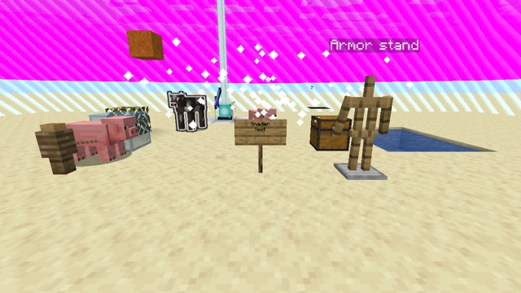](images/programs/sky-hud.jpg) |
| `clouds` | Clouds | `clouds`, `flat_clouds` | [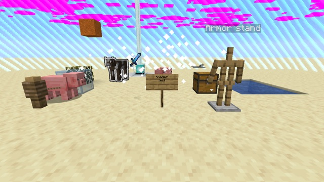](images/programs/clouds-hud.jpg) |
| `world_border` | The world border wall | `world_border` | [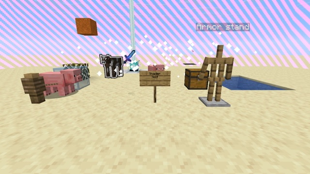](images/programs/world_border-hud.jpg) |
| `rendertype_entity_shadow` | Round shadows under entities | `entity_shadow` | [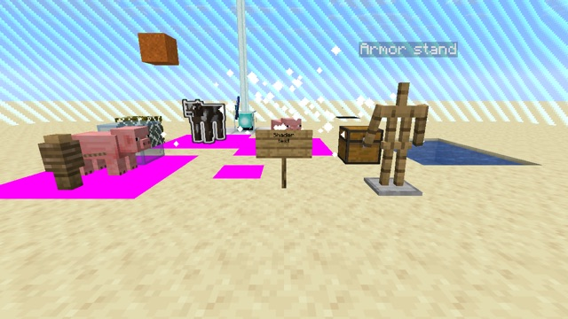](images/programs/rendertype_entity_shadow-hud.jpg) |
| `rendertype_beacon_beam` | Beacon beams | `beacon_beam_opaque`, `beacon_beam_translucent` | [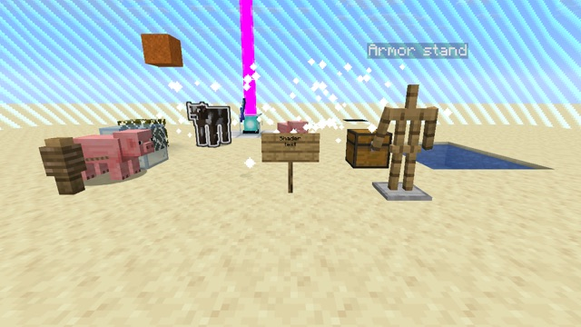](images/programs/rendertype_beacon_beam-hud.jpg) |
| `rendertype_end_portal` | End portal and end gateway blocks | `end_portal`, `end_gateway` |  |
| `rendertype_leash` | Leads | `leash` | [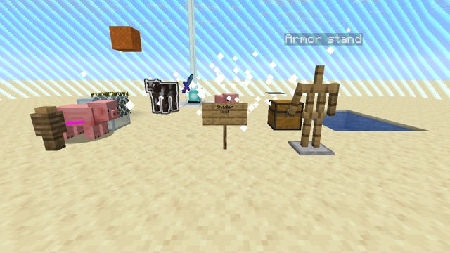](images/programs/rendertype_leash-hud.jpg) |
| `rendertype_outline` | Glowing entities, into the outline target (here the cow) | `outline_cull`, `outline_no_cull` | [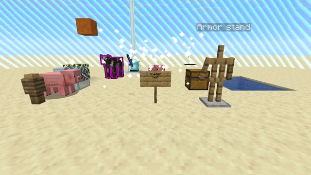](images/programs/rendertype_outline-hud.jpg) |
| `blit_screen` | Full-screen copies, including the outline composite. Forcing it opaque covers the whole screen | `entity_outline_blit`, `blit_depth_bounds`, `tracy_blit` | [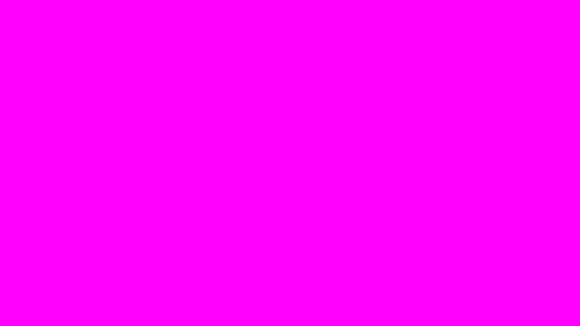](images/programs/blit_screen-hud.jpg) |
| `text` | All text and its background: chat, name tags (text and box), sign text | `text*`, `gui_text*` | [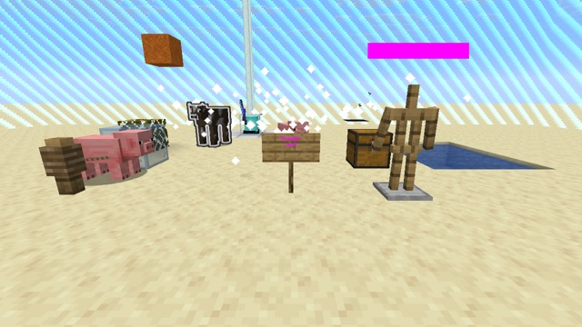](images/programs/text-hud.jpg) |
| `rendertype_lines` | The outline of the block you look at (only with the HUD shown), debug lines | `lines*`, `secondary_block_outline` |  |
| `gui` | Untextured GUI rectangles, such as the chat background | `gui`, `gui_invert`, `gui_text_highlight` |  |
| `position_tex_color` | Textured GUI (hotbar, toasts), the vignette, screen overlays | `gui_textured`, `vignette`, `crosshair`, `fire_screen_effect`, `end_sky`… |  |
| `position_tex` | The sun and the moon (not in view here) | `celestial` |  |
| `position_color` | The sunrise and sunset glow, debug shapes (not in view here) | `sunrise_sunset`, `debug_*` | [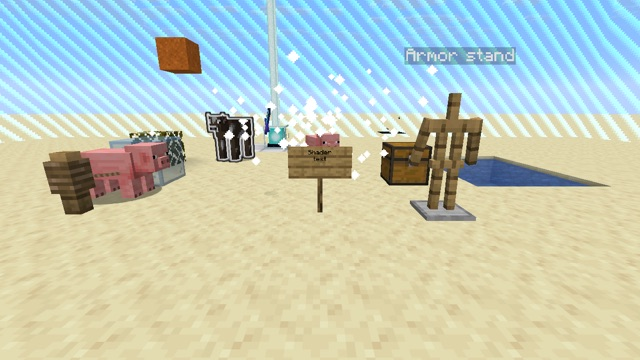](images/programs/position_color-hud.jpg) |
| `stars` | Stars (not visible at noon) | `stars` | [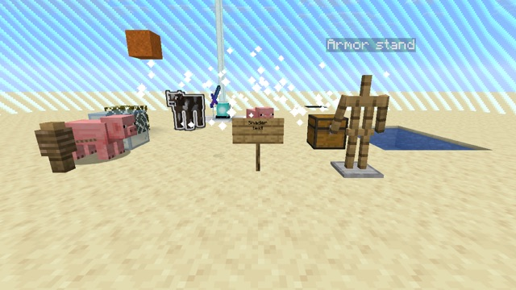](images/programs/stars-hud.jpg) |
| `rendertype_lightning` | Lightning, ender dragon death rays | `lightning`, `dragon_rays` |  |
| `rendertype_crumbling` | Block-breaking cracks | `crumbling` |  |
| `rendertype_water_mask` | A depth-only water mask (not in this scene) | `water_mask` | [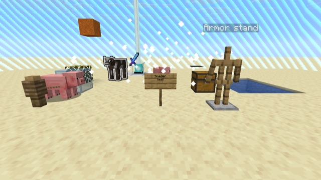](images/programs/rendertype_water_mask-hud.jpg) |
| `glint` | Not seen in this scene: item glint goes through `item` and `entity` with `GLINT` | `glint` |  |

The "Draws" column describes what the screenshots show. The "Pipelines" column comes from the [pipeline reference](reference/pipelines.md). For the program and pipeline names, see [core-shaders.md](reference/core-shaders.md).

### Surprises

- **Signs are terrain.** The sign board and post are part of the chunk mesh (`terrain`), and only the text on them is drawn by `text`. Chests, on the other hand, go through `entity`.
- **The vignette is a full-screen `position_tex_color` quad** that multiplies the image: the magenta pack turned the whole screen green.
- **`blit_screen` covers the screen** when forced opaque, because the glowing-outline composite is a full-screen pass that normally relies on transparency.
