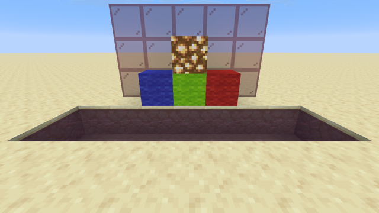
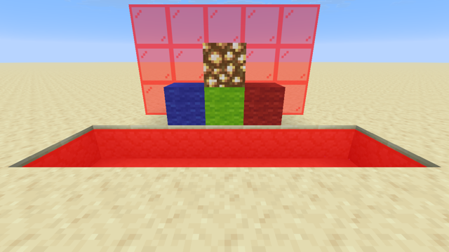
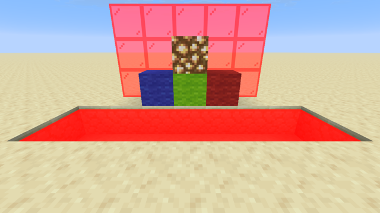

# Techniques (26.3)

Recurring tricks of vanilla shader packs, checked in 26.3. Each one links to the experiment or example that shows it working.

## Contents

- **Know what you are drawing:** [Mark texels in a texture](#mark-texels-in-a-texture), [Pass data from a datapack](#pass-data-from-a-datapack), [Tell the GUI from the world](#tell-the-gui-from-the-world), [Isolate an element of the GUI](#isolate-an-element-of-the-gui), [Detect the Nether](#detect-the-nether)
- **Read the state of the world:** [Camera, world position and field of view](#camera-world-position-and-field-of-view), [Read light levels](#read-light-levels), [Animate](#animate)
- **Change the rendering:** [Change the color of translucent things (Improved Transparency)](#change-the-color-of-translucent-things-improved-transparency), [Change something everywhere: replace a vanilla include](#change-something-everywhere-replace-a-vanilla-include), [Displace geometry](#displace-geometry), [Wave plants](#wave-plants), [Restyle glowing outlines](#restyle-glowing-outlines)
- **Post effects:** [Tag pixels for a post effect](#tag-pixels-for-a-post-effect), [Send a value or a position to a post effect](#send-a-value-or-a-position-to-a-post-effect), [Give post effects the camera: a data bus](#give-post-effects-the-camera-a-data-bus), [Read depth in a post effect](#read-depth-in-a-post-effect), [Reconstruct positions in a post effect](#reconstruct-positions-in-a-post-effect), [Mark translucent surfaces for a post effect: water](#mark-translucent-surfaces-for-a-post-effect-water), [Relight terrain in a post effect](#relight-terrain-in-a-post-effect), [Shadows in screen space](#shadows-in-screen-space), [Reuse the previous frame](#reuse-the-previous-frame), [Tell the hand from the world in a post effect](#tell-the-hand-from-the-world-in-a-post-effect), [A top-down map: draw terrain a second time](#a-top-down-map-draw-terrain-a-second-time)

## Mark texels in a texture

A shader can't know which object it is drawing, but it can read the texture. Packs therefore mark special texels with a value nobody would paint by accident.

- **Marker alpha:** for example 254 instead of 255. It's invisible in an opaque texture, and easy to test: `abs(texel.a * 255.0 - 254.0) < 0.5`. See [emissive-entities](../examples/emissive-entities/).
- **Exact colors:** compare the texel's color with a list of colors, with a small tolerance.
- **Coordinates:** a texel can carry its own position in the sprite (green = x, blue = y), so the shader can draw a procedural shape across it. See [procedural-sprite](../examples/procedural-sprite/).

Read the texel without mipmapping, with `textureLod(Sampler0, uv, 0.0)`, so neighbouring texels don't change the value. This works for entities and items (examples above).

**Terrain is different.** Its `Sampler0` uses linear filtering, and vanilla's `sampleNearest()` (`texture_sampling.glsl`) still blends neighbouring texels near texel edges, for anti-aliasing *(code)*. To read one exact texel, use `texelFetch(Sampler0, ivec2(uv * vec2(TextureSize)), 0)`, where `TextureSize` comes from the `TerrainUniform` block. In [exp 68](../experiments/68-terrain-texelfetch/), a quarter of the red wool texture recolored #FE0102 turns magenta with sharp edges, on every face.

## Pass data from a datapack

Commands can set colors that reach a shader unchanged, in the `Color` vertex input. A shader that compares the raw `Color` with an exact value can react to it, and the other 24 bits of the color can carry data.

- **Text color:** a `text_display`, `/title` or any text with `"color": "#FE0102"` reaches `core/text.vsh` in `Color` ([exp 66](../experiments/66-data-text-color/)).
- **Item tint:** an item tinted with `dyed_color` (here a `leather_horse_armor` in an `item_display`) reaches `core/item.vsh` in `Color` ([exp 67](../experiments/67-data-item-tint/)).

```glsl
// In the vertex shader, before Color is multiplied by lighting.
if (all(lessThan(abs(Color.rgb * 255.0 - vec3(254.0, 1.0, 2.0)), vec3(0.5)))) {
    // this vertex carries the marker #FE0102
}
```

In both experiments, a control in `#FE0103` is left untouched. [text-effects](../examples/text-effects/) uses this to trigger rainbow and wave effects on any text. Compare in the vertex shader, on the raw `Color`: the fragment shader only sees it after lighting and the lightmap.

## Tell the GUI from the world

The same program draws an item in the world, in hand and in the hotbar. GUI drawing uses an orthographic projection, the world a perspective one:

```glsl
#include <minecraft:projection.glsl>   // ProjMat; the Projection block is available to item, entity, text, gui…

bool inGui = ProjMat[2][3] == 0.0;
```

In [exp 59](../experiments/59-gui-or-world/), `core/item.fsh` turns magenta only when `inGui` is true. The hotbar icons turn magenta, while the dropped sword and the one held in hand are unchanged, on both backends. [gui-theme](../examples/gui-theme/) uses the same test to recolor the GUI textures only.

## Isolate an element of the GUI

**Item icons in the GUI are drawn twice** *(the game has a `GuiItemAtlas` class)*:
1. **`core/item` draws them into an atlas** of item icons. There, `gl_Position` is a position **in the atlas**, not on the screen ([exp 71](../experiments/71-gui-item-atlas/): a left-to-right rainbow in `item.vsh` colors the hotbar icons in no particular order).
2. **`core/position_tex_color` copies them to the screen**, together with every other GUI texture: hotbar, hearts, toasts, containers. There, `gl_Position` is the real screen position ([exp 70](../experiments/70-gui-position/): the same rainbow follows the hotbar slots, icons included).

So **to select GUI elements by where they are, work in `position_tex_color.vsh`**, in normalized device coordinates. `x` goes from -1 on the left to 1 on the right, and `y` from **-1 at the bottom** to 1 at the top, on both backends. In [exp 72](../experiments/72-gui-bottom/), `gl_Position.y / gl_Position.w < -0.6` tints exactly the hotbar area. To select by *what* they are, use the texture: texel markers ([above](#mark-texels-in-a-texture)) work on GUI sprites too.

Positions in normalized coordinates don't depend on the window size, but the size of GUI elements does, since it follows the GUI scale.

## Detect the Nether

The light directions of the `Lighting` block (`Light0_Direction`, `Light1_Direction`) depend on the dimension *(code)*. With Nether lighting, the second light points down:

```glsl
#include <minecraft:light.glsl>   // Lighting: available to item, and to entity variants that use lighting
bool netherLighting = Light1_Direction.y < 0.0 && ProjMat[2][3] != 0.0;
```

- **In the Nether, a pig tinted by this test turns red. The same shader leaves it unchanged in the Overworld** ([exp 75](../experiments/75-nether-lighting/), [exp 76](../experiments/76-overworld-lighting/)).
- **Exclude the GUI:** entities shown in the GUI are lit from below too, hence the orthographic test.
- **This detects Nether-style lighting, not the Nether itself.** The game picks the lighting from the dimension type's cardinal light type (`dimensionType().cardinalLightType()`) *(code)*. A custom dimension with that type is detected too. The End and the Overworld share the default lighting, so this test can't tell them apart.

## Camera, world position and field of view

| What | How | Evidence |
|---|---|---|
| Camera position (world) | `vec3(CameraBlockPos) - CameraOffset` (`Globals`) | *(code)* |
| World position, entities | `Position + vec3(CameraBlockPos) - CameraOffset`: their `Position` is relative to the camera | [exp 74](../experiments/74-entity-world-position/) |
| World position, terrain | `Position + vec3(ChunkPosition)` | [terrain-wave](../examples/terrain-wave/) |
| Vertical field of view | `degrees(2.0 * atan(1.0 / ProjMat[1][1]))`: 70 with the default FOV option, more when flying or sprinting (dynamic FOV is in `ProjMat`) | [exp 73](../experiments/73-fov-from-projection/), [data-bus](../examples/data-bus/) |

In `entity.vsh`, the `PER_FACE_LIGHTING` variants (`entity_cutout` and others: mobs, for example) output `vertexPerFaceColorFront` and `vertexPerFaceColorBack` instead of `vertexColor`. An effect on the vertex color has to change both outputs, or it won't show on most mobs.

## Read light levels

The vertex input `UV2` (`ivec2`) holds the two light levels of the vertex, multiplied by 16 *(code: `sample_lightmap.glsl` reads `UV2 / 256`)*:

```glsl
float blockLight = float(UV2.x) / 16.0;   // 0..15: torches, glowstone, lava...
float skyLight   = float(UV2.y) / 16.0;   // 0..15: light from the sky
```

- **The levels don't depend on the time of day.** In [exp 69](../experiments/69-light-levels/), `terrain.vsh` shows block light in red and sky light in green. At midnight, open ground is still full green (sky light 15), and only the area around glowstone gets red. Day and night are applied afterwards, by the lightmap texture (`Sampler2`) that `sample_lightmap()` reads.
- **With smooth lighting, the values are interpolated** between levels, so compare with thresholds rather than exact levels.
- **Vanilla also shades each face by its direction**, in the vertex color: up 1, down 0.5, north and south 0.8, east and west 0.6 (`CardinalLighting.DEFAULT`; in the Nether, up and down are both 0.9) *(code)*.
- **`UV2` reaches the vertex programs that have it in their vertex format:** `terrain`, `block`, `entity`, `item`, `particle`, `text`, `rendertype_leash`… ([core-shaders.md](reference/core-shaders.md)). To use it in the fragment shader, pass it through a varying.

Use it for light-dependent effects that vanilla's lightmap can't express, like emissive parts that only glow in the dark, or a custom day/night curve, using `GameTime` for the time of day.

## Animate

- **Use `GameTime` from `Globals`**, available to almost every core program (see [core-shaders.md](reference/core-shaders.md)) and to every post pass. It is `((game ticks % 24000) + partial tick) / 24000`: it goes from 0 to 1 every 24000 ticks (20 minutes), then **wraps back to 0** *(code)*. For a seamless loop, use a whole number of periods: `sin(GameTime * 6.2831853 * N)` repeats N times per wrap, that is every 24000 / N ticks. See [terrain-wave](../examples/terrain-wave/).
- **`CameraOffset` and `CameraBlockPos` give the camera position:** `CameraBlockPos` is the block the camera is in, and `CameraOffset` is `CameraBlockPos - camera position`, between -1 and 0 on each axis *(code)*.
- **Post-effect uniforms from the JSON are constants**, so they can't drive an animation ([Post effects](post-effects.md)).

## Change the color of translucent things (Improved Transparency)

With the **Improved Transparency** graphics option, translucent terrain, entities, particles and clouds go through order-independent transparency (OIT). The same program then runs in three passes, selected by defines (see [How a frame is drawn](rendering.md)):
- `OIT_DEPTH_BOUNDS` and `OIT_TRANSMITTANCE`, together `OIT_ALPHA_ONLY`: only the alpha counts, and there is no `fragColor`;
- `OIT_ACCUMULATE`: the color is weighted by `sampleColorForAccumulation()` inside vanilla's `calculateFinalColor()`.

**Change `color` before `calculateFinalColor()`, never `fragColor` after it.**

| | Improved Transparency off | Improved Transparency on |
|---|---|---|
| Red tint applied to `color` before `calculateFinalColor()` |  exp 60 |  exp 61 |
| `fragColor` overwritten after `calculateFinalColor()` |  exp 62 |  exp 63 |

- **Changed before**, the tint looks the same with the option on or off.
- **Overwritten after**, the color skips the OIT weighting. The water and glass come out brighter and more opaque with the option on.

If you change alpha, change it in the `OIT_ALPHA_ONLY` path too, so the transmittance passes see the same alpha as the color pass *(code)*.

The option is off by default. To turn it on from `options.txt`, also set `graphicsPreset:"custom"`: a named preset ("fancy"…) re-applies its own values when the options load. `tools/launch.py --option` handles this.

## Change something everywhere: replace a vanilla include

A pack file at `assets/minecraft/shaders/include/<name>.glsl` replaces the vanilla include for every program that includes it. For example, a modified `fog.glsl` changes the fog of terrain, entities, items, particles, sky and clouds at once. See [atmosphere](../examples/atmosphere/).

- **Keep every block and function the vanilla file declares**, with the same signatures. Other programs call them.
- **Run `tools/mcshaders check`:** a mistake in an include breaks every program that uses it.

## Displace geometry

A vertex shader can move vertices freely. Only the rendering changes: collisions are unaffected, and terrain lighting, which is baked into the vertex color, does not follow the new shape. For terrain, rebuild the world position as `Position + vec3(ChunkPosition)`. See [terrain-wave](../examples/terrain-wave/).

## Wave plants

`terrain.vsh` doesn't know which block it draws. Plants can still be found: in the cutout layer (`ALPHA_CUTOUT` 0.5), tinted by the biome (a `Color` that isn't grey), and off the block grid in x or z (cross models are inset by a pixel; the grass block, also tinted and cutout, is on the grid). Their tops can't be found, though:

- **`gl_VertexIndex % 4` is not stable for terrain:** coloring vertices by it gave different corners of the same plants from one run to the next, and other ones on OpenGL;
- **`UV0` lies on the sprite's corners,** which neighbouring sprites in the atlas share;
- **both ends of a plant are at whole block heights.**

So sway whole plants, a little, with a wind whose phase changes with height. [waving-plants](../examples/waving-plants/) does this, in Sodium's terrain shader too, with Sodium's per-region clock ([Sodium](sodium.md)).

## Restyle glowing outlines

Replace the post effect `assets/minecraft/post_effect/entity_outline.json`. It reads the silhouettes of glowing entities from the `minecraft:entity_outline` target (team color in RGB, coverage in alpha), and must write the outline back into that target, alpha included. The game then composites it onto the world. See [thick-outlines](../examples/thick-outlines/).

## Tag pixels for a post effect

A post effect only sees the final image. To let it treat some pixels differently, the core shader that draws them writes a **tag in the alpha channel of `minecraft:main`**.

- **After the world is drawn, alpha is 1 almost everywhere:** terrain, sky, entities, water and glass alike. It is 0 only where nothing was drawn, such as the band at the horizon of a flat world ([exp 58](../experiments/58-main-alpha/)). A value like 0.5 is therefore free.
- **Except far away and in front of the sky.** Cutout blocks (leaves, grass, seagrass) write the alpha of their texture, and far away their mipmaps blur it below 1. Translucent surfaces with nothing behind them, such as clouds and far water, leave the clear alpha (0) partly showing ([scattered-sky](../examples/scattered-sky/)). Check the tag with a tolerance, or make cutout write alpha 1.
- **Only tag from pipelines without blending.** Solid and cutout pipelines (`entity_solid`, `entity_cutout`, `item_cutout`, `solid_terrain`, `cutout_terrain`…) store the alpha as written. Translucent ones blend it. The blend state of every pipeline is in [pipelines.json](../reference/26.3/pipelines.json) (`color_targets`).
- **The post effect tests the tag**, for example `abs(color.a - 0.5) < 0.1`. It should write alpha 1 when it is done.

Example: [emissive-glow](../examples/emissive-glow/) tags emissive texels and blooms only them.

## Send a value or a position to a post effect

Tagging pixels ([above](#tag-pixels-for-a-post-effect)) tells a post effect *which* pixels matter. To send a **value**, such as the screen position of a point in the world, a core shader writes it into **control pixels**, at a fixed place on the screen:

- **In the vertex shader,** recognize the source, for example an item tinted with a marker color ([exp 67](../experiments/67-data-item-tint/)). Compute the value, pass it in a `flat` varying, and move the vertex onto a small strip in a corner.
- **In the fragment shader,** write a marker and the value, as bytes with alpha 1.
- **In the post effect,** find the marker with `texelFetch`, decode the value, then paint over the strip.

[world-anchor](../examples/world-anchor/) does this end to end, and lists what had to be found out along the way. NDC (-1, -1) is the bottom-left corner on both backends. The moved quad must stay front-facing, since back faces are culled. And the vertex a `flat` varying comes from differs between OpenGL and Vulkan.

## Give post effects the camera: a data bus

Post effects have no `ProjMat` and no view matrix, so they can't turn depth into a direction or a position. Control pixels can carry them, but the strip must survive the whole frame. [data-bus](../examples/data-bus/) reserves **column x = 0 of the screen**:

- **Every program that draws the world discards its fragments in that column**, unless the render is orthographic (`ProjMat[2][3] == 0`: the GUI and the GUI icon atlas).
- **`core/sky` writes `ProjMat`, its `ModelViewMat` (the camera's rotation), the sky color and `FogColor` there.** A float fits in a pixel as 4 bytes, through `floatBitsToUint`, because the sky pipeline doesn't blend.
- **`core/position_tex` adds the sun's direction.** The sun is the quad with scale 30 (the moon's is 20). Its pipeline blends additively, so the sky clears its rows to black first, and the value goes in RGB with alpha 1.
- **The post effect decodes the column, then paints it over.** View direction of a pixel: `inverse(proj) * vec4(ndc, 1, 1)`. World direction: `transpose(mat3(view))` times that.

The sky and the sun have no depth test and no depth write, and are drawn first ([How a frame is drawn](rendering.md#frame-order)), so whatever they write is overwritten by later draws unless those discard. There is no bus where the sky disc isn't drawn: the post effect must check the marker first.

## Read depth in a post effect

Use `"use_depth_buffer": true` on an input. Depth is reversed: 1 near, 0 far and sky ([exp 57](../experiments/57-depth-input/)). It is roughly proportional to 1 / distance, so compare relative differences. See [depth-outlines](../examples/depth-outlines/). The first-person hand is in that depth, at the wrong place ([below](#tell-the-hand-from-the-world-in-a-post-effect)).

## Reconstruct positions in a post effect

With the projection and the view rotation from a [data bus](#give-post-effects-the-camera-a-data-bus), a post effect can turn the depth of a pixel back into a position:

```glsl
// Vulkan stores depth in [0, 1], OpenGL on macOS in [-1, 1]: the projection is built for the device's range.
// JOML's reversed perspective has proj[2][2] = near / (far - near) for [0, 1], (far + near) / (far - near) for [-1, 1].
bool zeroToOne = proj[2][2] < 0.5;
float z = zeroToOne ? depth : depth * 2.0 - 1.0;
vec4 p = inverse(proj) * vec4(texCoord * 2.0 - 1.0, z, 1.0);
vec3 viewPos = p.xyz / p.w;
vec3 position = transpose(mat3(view)) * viewPos;   // world axes, relative to the camera
```

Both ranges were observed: `proj[2][2]` reads below 0.5 on Vulkan and above on OpenGL ([scattered-sky](../examples/scattered-sky/)). On sky pixels (depth 0), any `z` gives the right direction.

From `position`, vanilla's fog is `max(linear(length(position), FogEnvironmentalStart, FogEnvironmentalEnd), linear(max(length(position.xz), abs(position.y)), FogRenderDistanceStart, FogRenderDistanceEnd))`, as in `fog.glsl`. The distances depend on where the camera is:

| Camera | Environmental | Render distance | `FogSkyEnd` | `FogCloudsEnd` |
|---|---|---|---|---|
| Air, clear (16 chunks) | 0 to 1024 | 233 to 256 | 256 | 1024 (the cloud range option) |
| Air, rain | start down by up to 160, end down to 768 | same | same | same |
| Water | -8 to 96 (shorter with poor water vision) | same | 96 | 96 |
| Blindness, darkness | short, from the effect | same | 0.8 or 1 × environmental end | same as the sky |

The distances in air and the ends in water were read in game, the rest comes from the code (`FogRenderer` and the fog environments). So a post effect can tell air from water: in air, `FogSkyEnd` is the render distance (up to 512) and is less than `FogEnvironmentalEnd`. [scattered-sky](../examples/scattered-sky/) uses this to replace the fog color with a sky only in air.

## Mark translucent surfaces for a post effect: water

[Tagging pixels](#tag-pixels-for-a-post-effect) through alpha only works from pipelines without blending. Water is translucent, but a translucent fragment that writes **alpha 1** replaces the pixel exactly (`SRC_ALPHA, ONE_MINUS_SRC_ALPHA`). So the fragment shader can write a marker instead of the water, on part of the pixels:

- **Recognize water** in `core/terrain`: water textures have a uniform alpha of 180/255, and water is tinted by the biome. The slime block also has alpha 180, but it is white. Pass the raw `Color` from `terrain.vsh` to tell them apart.
- **Write a marker on every other column**, and let the other columns blend as usual: the post effect gets both the marker and what is underneath. A marker that depends on the column (two bytes, for example) almost never matches a scene color by chance.
- **Use `gl_FragCoord.x` only.** Whether `gl_FragCoord.y` counts from the same edge on both backends was not tested here.
- **The depth buffer holds the water surface**: translucent terrain writes its depth ([pipelines.json](../reference/26.3/pipelines.json)).
- **Do the same in Sodium's terrain shader** for Sodium players ([Sodium](sodium.md)).

[water-reflections](../examples/water-reflections/) uses this for waves, screen-space reflections, refraction and Fresnel.

## Relight terrain in a post effect

A post effect only sees albedo × light. With the light levels it can still change the light, by a factor:

- **Write the light levels in the alpha of opaque terrain.** Solid and cutout terrain don't blend, so `terrain.fsh` can write `UV2` there, as a small code. Keep the code away from the values that translucent things leave in front of the clear color: clouds reach at most 0.8.
- **Divide out what vanilla did, multiply in what you want.** Vanilla's sky light is uniform but for the fixed shade per face ([above](#read-light-levels)). Your own can follow the sun, with a normal from the depth's derivatives. Normalize it so that a face pointing up keeps vanilla's brightness, and mix the factor with 1 by the share of sky light in the pixel: block light is then left alone.
- **Without the data that drives it, nothing changes:** where there is no [data bus](#give-post-effects-the-camera-a-data-bus) (Nether, underwater), the vanilla image stays as it is.

[sun-lighting](../examples/sun-lighting/) does this, with light colors from the [scattered sky](../examples/scattered-sky/) and bloom.

## Shadows in screen space

With the camera from a [data bus](#give-post-effects-the-camera-a-data-bus), a post effect can march a ray from each pixel toward the sun against the depth buffer: if the visible surface at some step is in front of the ray, the pixel is in shadow. Only what is on screen casts shadows. The difficulty is that the depth buffer only shows the front of things:

- **Count the ray as blocked within a window behind the visible surface,** about the depth of a block seen at an angle (up to about 1.7 blocks), plus a margin.
- **Keep every step shorter than that margin,** or the ray jumps over a one-block slab: cap the step length rather than letting it grow.
- **Fade the blocking out toward the end of the window.** With a hard limit, whether a ray counts as blocked depends on where its samples fall, and the shadow's edge becomes a comb. A window that grows with the steps gives teeth instead: rays that pass *behind* a thin pillar, as seen from the camera, count as blocked.

[screen-shadows](../examples/screen-shadows/) shows the values that work, and the artifacts of the ones that didn't.

## A top-down map: draw terrain a second time

A vertex goes to one place on screen, so the terrain can't be drawn both in the world and on a map. Its models can, though:

- **Give each block model a second top face, inside the model, at a height no vanilla model uses.** `terrain.vsh` recognizes it by `fract(Position.y)` and sends it to the map, while the world keeps the real faces. The height must be free on every axis, its opposite (16 − h) too, because blockstates turn models. 1.5/16, the obvious choice, is taken by repeaters and tripwires ([exp 77](../experiments/77-minimap-capture/)).
- **Place the map faces from the camera's block,** `Position + ChunkPosition - CameraBlockPos`: their corners are then whole numbers, and each block covers exactly one pixel of a square of the screen. `terrain.fsh` keeps everything else out of that square, and tags map pixels in alpha.
- **One frame only has the sections in view.** A `persistent` post target indexed by world position, `CameraBlockPos` in the post effect's `Globals`, keeps what each frame captured, and the map fills as the camera turns ([exp 78](../experiments/78-minimap-memory/), against [exp 79](../experiments/79-minimap-memory-control/)).
- **A face inside a block gets the sky light of the open air above it,** and one level less per block of water ([exp 80](../experiments/80-map-face-light/)): enough to show water, which has no model.

[minimap](../examples/minimap/) draws a round map, turned with the view, from this.

## Reuse the previous frame

A [persistent target](post-effects.md#targets) keeps its content from one frame to the next. With the camera of a [data bus](#give-post-effects-the-camera-a-data-bus), a post effect can find where each pixel was in the previous frame:

- **Store this frame's camera** in a small persistent target, as floats in 4 bytes: the projection, the view rotation, and the camera's world position (`vec3(CameraBlockPos) - CameraOffset`). Do it in one of the last passes, so that the next frame reads the previous camera.
- **Reproject:** the pixel's world position, from its depth, through the previous camera. For the sky, at infinity, only the rotation counts.
- **A persistent target starts cleared to transparent black:** write alpha 1 into it, and treat alpha 0 as "no previous frame yet".

[temporal-accumulation](../examples/temporal-accumulation/) blends each frame with the reprojected previous result, clamped to the current neighbourhood so that nothing trails. Core shaders have no frame counter to jitter the projection with, so this smooths noise and shimmering, but doesn't anti-alias still edges.

## Tell the hand from the world in a post effect

The first-person hand and held items are merged into the depth a post effect reads, with their own projection ([How a frame is drawn](rendering.md#frame-order)): at 1 to 2 blocks, like the ground at one's feet, so depth alone can't tell them apart. Without care, the hand casts screen-space shadows on the ground, gets occlusion, and leaves trails in temporal effects.

- **Tagging it in alpha doesn't work:** the player's skin is drawn with a translucent pipeline, whose blending adds part of the alpha behind, so a written 253 came out as 255 (observed).
- **Squeeze its depth instead,** in `entity.vsh` and `item.vsh`: a vertex within 1.5 blocks of the eye, with a perspective projection (GUI items are orthographic), is the hand. Move its depth into the thousandth next to the near plane, keeping its order: `ndc = 1.0 - (1.0 - ndc) * 0.001` (depth is reversed, 1 is near). Nothing of the world is ever that close, so in the post effect a depth above 0.9985 is the hand, on both backends (observed).
- **The view bobbing is in `ProjMat`** *(code: `projectionMatrix.mul(bobStack)`)*: a translation of a few hundredths of a block. To turn a sky pixel into a direction, unproject a point at the far plane (depth near 0), not a near one, or the direction swings with each step.
