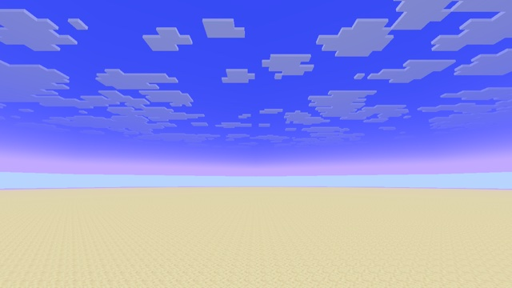

# Atmosphere



Two techniques together:
- **Replace a vanilla include**: a pack copy of `fog.glsl` makes the fog smoother and violet, for every program at once.
- **Add a varying to a core program**: the sky gets a gradient from the horizon to the zenith.

## Replacing `fog.glsl`

`assets/minecraft/shaders/include/fog.glsl` in the pack replaces the vanilla include for **every program that includes it**: terrain, entities, items, particles, sky, clouds… ([core-shaders.md](../../docs/reference/core-shaders.md) shows who uses `Fog`). The example changes only the last line of `apply_fog`:

```glsl
// Smoother fog curve, and fog tinted towards violet.
fogValue = smoothstep(0.0, 1.0, fogValue);
vec3 tinted = fogColor.rgb * vec3(1.05, 0.8, 1.2);
return vec4(mix(inColor.rgb, tinted, fogValue * fogColor.a), inColor.a);
```

- **Keep everything the vanilla file declares**: the `Fog` block exactly as it is, and every function with its signature. Other programs call them.
- **Keep the include guard,** so that including the file twice stays harmless, in vanilla programs as in your own.
- **One file is a single point of failure:** a mistake breaks every program that includes it. Run `tools/mcshaders check`, which compiles them all.

## Sky gradient

The upper sky is a disc drawn by `core/sky`, with a uniform color (`ColorModulator`). The vertex shader passes the elevation of each vertex to the fragment shader, in a new varying at a free location:

```glsl
// sky.vsh
layout(location = 2) out float skyElevation;
skyElevation = normalize(Position).y;      // 1 straight up, about 0 at the rim

// sky.fsh
layout(location = 2) in float skyElevation;
vec3 zenith = ColorModulator.rgb * vec3(0.45, 0.4, 0.95);
vec4 sky = vec4(mix(ColorModulator.rgb, zenith, clamp(skyElevation * 1.4, 0.0, 1.0)), ColorModulator.a);
fragColor = apply_fog(sky, ...);           // vanilla passed ColorModulator
```

The sky disc is only drawn by `core/sky`, so the new varying only has to match there. [core-shaders.md](../../docs/reference/core-shaders.md) lists each program's partners: always check them before changing an interface.

## Try it

```sh
python3 tools/examples.py atmosphere --out ~/Desktop
```
