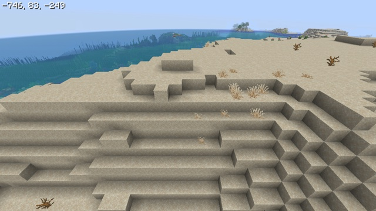

# Coordinates



The block the player stands in, printed as `x, y, z` in the top-left corner, in the game's own font, with no mod and no command. A post effect reads the camera's position from `Globals` and draws the text itself. The [minimap](../minimap/) and [minimap-sodium](../minimap-sodium/) examples print the same line under their map.

## How

**1. The position comes from `Globals`**, which every post pass has ([Post effects](../../docs/post-effects.md#the-shaders)). `CameraBlockPos` is the block the camera is in, `floor` of its position, and `CameraOffset` is `CameraBlockPos` minus the position, so `-CameraOffset` is the camera's fraction, from 0 to 1 *(code: `GlobalSettingsUniform`)*. `CameraBlockPos` is an `ivec3`: the whole part is exact at any distance from the origin, and only the fraction goes through a float.

**2. The camera is at the eyes, not the feet.** In first person it is 1.62 blocks above the feet when standing, flying or in spectator mode *(code: `Camera`)*. [text.glsl](text.glsl) subtracts that height from the camera's fraction and takes the block of the result:

```glsl
float y = -CameraOffset.y - EYE_HEIGHT;   // EYE_HEIGHT = 1.62
ivec3 feet = CameraBlockPos + ivec3(0, int(floor(y + 0.00001)), 0);
```

The small margin matters. Standing on a block, the camera read 5.619999885559082 for feet at 4.0, a little under 1.62 above them, so the fraction lands just below a whole number.

**3. The font is the game's** `font/ascii.png`. [text.py](text.py) copies it from the installed game into the pack when the example is built, as `assets/coordinates/textures/effect/ascii.png`. The post pass reads it as a texture input (`"location": "coordinates:ascii"`). The PNG is a grid of 16 × 16 cells of 8 × 8 pixels in ASCII order. A texture input reads upside down with the usual `texCoord` ([Post effects](../../docs/post-effects.md#passes)), so `texelFetch` row 0 is the PNG's top row, and the glyph of character `c` starts at `((c & 15) * 8, (c >> 4) * 8)`.

**4. A line of text is an array of character codes.** GLSL has no strings. `coordinatesLine()` writes the digits, the minus signs and the `, ` separators into an `int` array. A pixel walks along it to find its character, using the game's advances: the glyph's width plus one, which is 6 for the digits and the minus sign and 2 for the comma, measured in the PNG. The space has no glyph and advances by 4 (`font/include/space.json`). The text is white, with the game's shadow: one font pixel right and down, at a quarter of the color.

**5. Its size follows the GUI scale that "Auto" picks:** the largest that leaves at least 320 × 240 GUI pixels *(code: `Window.calculateScale`)*. A post effect can't read the GUI scale option, so with another scale set in the options the text keeps the "Auto" size.

## Checked in game

On OpenGL and Vulkan, with the test agent logging the game's own position next to each screenshot:

| Player | Printed |
|---|---|
| Spectator, feet at -1234.567, 70.25, 5678.875 | `-1235, 70, 5678` |
| Standing on the ground, feet at 10.5, 4.0, 10.5 | `10, 4, 10` |
| Sneaking there | `10, 3, 10`: one block too low (see below) |
| Third person there, camera at 10.5, 7.62, 7.04 | `10, 6, 7`: the camera's position (see below) |

With Sodium 0.9.2, the example works unchanged, since it changes no terrain shader.

## Limits

- **Sneaking, swimming, crawling and gliding lower the eyes.** The eye height is then 1.27 for sneaking and 0.4 for the others, and the `scale` attribute multiplies them all *(code: `Avatar`)*, so `y` reads one block too low when sneaking on a block and a block or two too low in the other poses. A post effect can't tell the poses apart. The camera also moves smoothly between the two heights, over a few ticks.
- **In third person, the coordinates are the camera's:** 4 blocks behind the player by default (the `camera_distance` attribute), closer when a wall is in the way *(code: `Camera`)*. Nothing tells a post effect which view is on.
- **The post effect runs before the GUI**, so F1 doesn't hide the coordinates, and screenshots include them. Menus, the chat and the debug screen are drawn over them.
- **The coordinates are interpolated** between ticks, as the camera is. The debug screen prints the position of the last tick instead *(code: `DebugEntryPosition`)*, so while moving the two can differ by a block at the moment one is crossed.

## Try it

```sh
python3 tools/examples.py coordinates --out ~/Desktop
```
