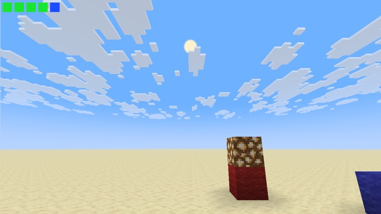

# Data bus



Post effects only get `Globals`: no projection, no view matrix, no sun direction. Without them, a post effect can't turn depth into a direction or a 3D position. This pack carries them through the image itself: **column x = 0 of the screen is reserved as a data bus**, written by core shaders and read by a post effect.

To show that the values are right, the post effect redraws the sky from them: a gradient from the fog color to the sky color along the world's vertical, and a sun disc at the decoded sun direction. The disc lands where vanilla draws the sun. The squares in the corner are its checks, all green: field of view, aspect ratio, view is a rotation, sun direction has unit length. The blue one says the bus starts at texel row 0.

## How

**1. Reserve the column.** Every program that draws the world discards its fragments there, at the start of `main()`:

```glsl
#define BUS_PROTECT if (gl_FragCoord.x < 1.0 && ProjMat[2][3] != 0.0) { discard; }
```

The example adds it to 20 programs: terrain, entities, items, particles, text, clouds, lines, glint, `oit_composite`… Orthographic renders are left alone (`ProjMat[2][3] == 0`), because `core/item` also draws the GUI icon atlas ([Techniques](../../docs/techniques.md#isolate-an-element-of-the-gui)). `blit_screen` has no `ProjMat` and always discards there.

**2. The sky disc writes the bus** (`core/sky`). It is drawn first, with `ModelViewMat` = the camera's rotation, and it has both matrices. `sky.vsh` moves its 10 vertices, a triangle fan, onto a 1-pixel-wide strip at the bottom of the column. `sky.fsh` writes one value per row:

| Rows | Content | Encoding |
|---|---|---|
| 0 | marker (magenta) | |
| 1–16 | `ProjMat` | float → 4 bytes (RGBA), `floatBitsToUint` |
| 17–32 | view rotation (`ModelViewMat`) | same |
| 33 | sky color (`ColorModulator`) | RGB |
| 34 | `FogColor` | RGB |
| 35–37 | black, cleared for the sun | |

**3. The sun adds its direction** (`core/position_tex`, which draws the sun and the moon). The sun is recognized by its scale: `length(ModelViewMat[0].xyz)` is 30 for the sun and 20 for the moon. Its center, `ModelViewMat * vec4(0, 0, 0, 1)`, gives its direction in view space. Each component is written to rows 35–37 as 24-bit fixed point in RGB.

**4. The post effect reads the bus** (`end_of_frame`). It finds the marker, decodes the values, and paints the column over with its neighbour. For a sky pixel (depth 0), the view direction is `inverse(proj) * vec4(ndc, 1, 1)`, and the world direction is `transpose(mat3(view))` times it.

What it took, observed on both backends:

- **The sky and the sun have no depth test and no depth write.** Anything drawn later overwrites what they write, wherever they write it. Hence the reserved column, protected in every later program.
- **The sun is drawn with additive blending** (`src * alpha + dst`). At first, its rows read as garbage: they held whatever the sky had left there. The sky now clears them to black, so the sum is exactly what the sun writes. Encode with alpha 1 for this writer, never 4 bytes.
- **The sky's `ModelViewMat` is a pure rotation:** its determinant is 1. The camera position is in `Globals`.
- **`ProjMat` includes the dynamic FOV effects.** Flying in spectator mode, the FOV check fails. Standing in creative mode, it reads exactly 70°.
- **Below y = 63, the `sky` program also draws a dark disc** under the horizon, translated 12 blocks down. Moved onto the bus like the sky disc, it rewrote the same rows after it, with a black sky color (observed underground in a normal world). `sky.vsh` drops it: its `ModelViewMat` has a translation, the sky disc's doesn't.
- **In a post effect, texel row 0 of `minecraft:main` is the bottom of the screen** (NDC y = -1). The example still looks for the marker in both the bottom and the top row.

## Limits

- **The moon, the stars and the sunrise glow disappear:** the post effect repaints every sky pixel. A real pack redraws them, or blends with the original image.
- **No bus when the sky disc isn't drawn.** According to the code, that is in lava, in powder snow, under effects that hide the sky, and in the Nether and the End. Not tested in game. The post effect then does nothing, because it looks for the marker first.
- **Column x = 0 shows its neighbour's colors.** At one pixel wide, this is invisible.

## Try it

```sh
python3 tools/examples.py data-bus --out ~/Desktop
```
