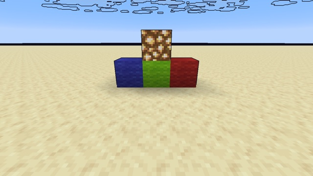

# Depth outlines



Dark lines wherever the depth jumps: around blocks, clouds and the horizon. It's a post effect, applied on every frame through `minecraft:end_of_frame`, with no core shader changed.

## How

[`end_of_frame.json`](example.json) runs two passes:
1. `outlines:post/depth_outline` reads the world's color (`In`) and depth (`InDepth`, `"use_depth_buffer": true`), and writes `swap`.
2. The vanilla `minecraft:post/blit` copies `swap` back to `minecraft:main`.

The fragment shader compares each pixel's depth with its four neighbours:

```glsl
float d = depthAt(vec2(0.0));
float jump = max(max(abs(depthAt(vec2(1.0, 0.0)) - d), abs(depthAt(vec2(-1.0, 0.0)) - d)),
                 max(abs(depthAt(vec2(0.0, 1.0)) - d), abs(depthAt(vec2(0.0, -1.0)) - d)));
float edge = step(Threshold, jump / max(d, 1e-5));
```

- **Depth is reversed in 26.3:** 1 near, 0 far, 0 for the sky ([exp 57](../../experiments/57-depth-input/)). It is roughly proportional to 1 / distance, so dividing the jump by the depth finds edges at any distance. The `max` avoids dividing by the sky's 0.
- **Neighbours are one texel apart**, using the input size from `SamplerInfo`: `OutSize`, then one size per input, in input order (`InSize`, `InDepthSize`).
- **`LineColor` and `Threshold` come from the JSON**, as the `OutlineConfig` block. The values are listed in declaration order.
- **The hand is not outlined:** when a post effect is active, the hand draws into its own depth buffer (see [How a frame is drawn](../../docs/rendering.md)).

## Try it

```sh
python3 tools/examples.py depth-outlines --out ~/Desktop
```
