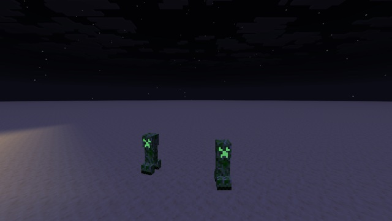

# Emissive entity pixels



The creeper's face glows at night while the rest of its body stays dark. The texture says which pixels glow, using a marker alpha, and `core/entity.fsh` skips the lightmap for them.

## How

**Texture.** The face pixels get an alpha of **254** instead of 255. The difference is invisible, but the shader can test for it. The example also recolors them bright green, because a black pixel stays black even when it ignores the lightmap. [`example.json`](example.json) does this to the vanilla `creeper.png` at build time.

**Shader.** Three edits to vanilla `core/entity.fsh`:

```glsl
// Set in main() for texels marked as emissive (alpha 254).
bool emissivePixel = false;

vec4 calculateFinalColor(vec4 color) {
    ...
    #ifndef EMISSIVE
    if (!emissivePixel) {
        color *= lightMapColor;      // vanilla: always
    }
    #endif
    ...
}

void main() {
    vec4 color = texture(Sampler0, texCoord0);
    // Texels with alpha 254 are emissive: drawn opaque, ignoring the lightmap.
    if (abs(color.a * 255.0 - 254.0) < 0.5) {
        emissivePixel = true;
        color.a = 1.0;
    }
    ...
}
```

- **The test is in `main`, on the raw texel**, before any tinting changes the alpha.
- **Only the lightmap is skipped.** Directional face shading and fog still apply, so the glow sits naturally in the scene.
- **Every variant keeps compiling.** `core/entity` is compiled in 37 variants. The edits only add code, and the lightmap line stays inside vanilla's `#ifndef EMISSIVE`, because `lightMapColor` does not exist in emissive variants. `tools/mcshaders check` verifies all of them.
- **Any entity texture drawn by `core/entity` can use the same marker**: mobs, armor, chests…

## Try it

```sh
python3 tools/examples.py emissive-entities --out ~/Desktop
```
