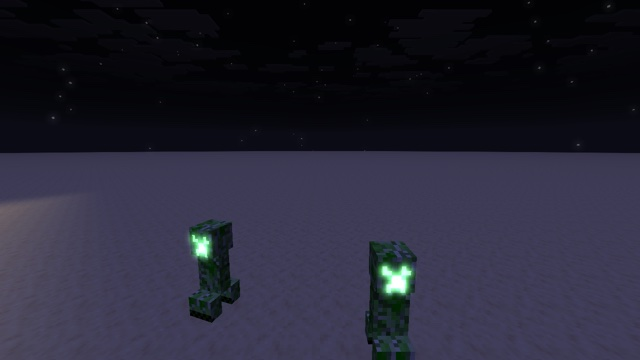

# Emissive glow



[emissive-entities](../emissive-entities/) makes some texels ignore the lightmap. This example also gives them a **glow**: a post effect blurs only those pixels and adds the blur back onto the image.

The difficulty is that a post effect only sees the final image: it can't know which pixels were emissive. The core shader tells it, by **tagging those pixels in the alpha channel of `minecraft:main`**. See [Techniques](../../docs/techniques.md#tag-pixels-for-a-post-effect).

## How

**Core shader** (`core/entity.fsh`): the emissive-entities edits, plus a tag at the very end:

```glsl
fragColor = calculateFinalColor(color);
// Tag emissive pixels for the post effect: entity_cutout/solid pipelines write alpha as is.
if (emissivePixel) {
    fragColor.a = 0.5;
}
```

**Post effect** (`end_of_frame`), four passes:

| Pass | Reads | Writes | Does |
|---|---|---|---|
| `glow:post/extract` | `minecraft:main` | `glow_a` | keeps the pixels with alpha ≈ 0.5, black elsewhere |
| `glow:post/blur` | `glow_a` | `glow_b` | 13-tap Gaussian, horizontal (`BlurConfig.Direction` = (3, 0)) |
| `glow:post/blur` | `glow_b` | `glow_a` | the same, vertical |
| `glow:post/combine` | `minecraft:main`, `glow_a` | `minecraft:main` | adds the blur × `GlowConfig.Strength` |

- **The tag survives until the post effect** because everything else the world draws leaves alpha at 1 ([exp 58](../../experiments/58-main-alpha/)). It also survives because creepers draw with `entity_cutout`, which has no blending: the alpha written is the alpha stored. Translucent pipelines blend, and would mix the tag.
- **The last pass reads and writes `minecraft:main`** directly ([exp 54](../../experiments/54-main-to-main/)). It only reads its own pixel there, and the blurred `glow_a` is a separate target.
- **The final pass writes alpha 1**, so the tag doesn't leak into later post effects.

## Try it

```sh
python3 tools/examples.py emissive-glow --out ~/Desktop
```
