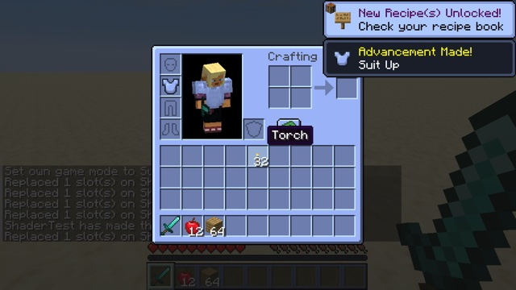

# GUI theme



The neutral greys of the GUI turn blue, while colored parts keep their colors. This covers the inventory, the hotbar, toasts and buttons. Only one program changes: `core/position_tex_color.fsh`, which draws textured GUI elements (see [How a frame is drawn](../../docs/rendering.md)).

## How

```glsl
#include <minecraft:projection.glsl>   // ProjMat; Projection is available to every position_tex_color pipeline

// In main(), before the output:
if (ProjMat[2][3] == 0.0) {             // orthographic projection: drawn in the GUI
    float lum = dot(color.rgb, vec3(0.299, 0.587, 0.114));
    float saturation = max(max(color.r, color.g), color.b) - min(min(color.r, color.g), color.b);
    if (saturation < 0.06) {             // a neutral grey
        color.rgb = lum * vec3(0.78, 0.9, 1.25);
    }
}
```

- **GUI only:** `position_tex_color` also draws the End sky in the world. The orthographic test ([exp 59](../../experiments/59-gui-or-world/)) keeps the theme out of it.
- **Greys only:** a texel with some saturation is left alone, such as the hearts. Item icons are drawn by `core/item` and text by `core/text`, so they are never affected.
- **The vignette also goes through this program:** it is a full-screen GUI quad that darkens the image ([How a frame is drawn](../../docs/rendering.md)). Its greys get the same tint, which slightly colors the darkening at the screen edges.
- **Vanilla redeclares `DynamicTransforms` by hand in this file**, with a comment explaining that it is used during startup, before resource packs exist. The pack keeps that declaration and only adds the `Projection` include.

## Try it

```sh
python3 tools/examples.py gui-theme --out ~/Desktop
```
