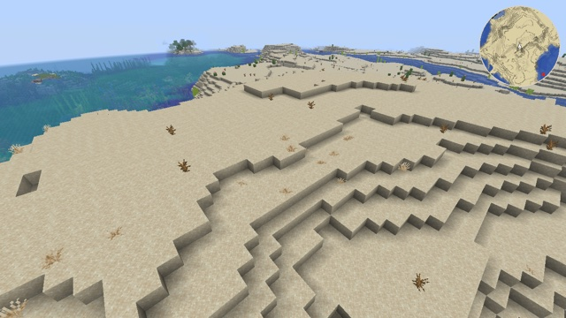

# Minimap for Sodium too



The [minimap](../minimap/) example, changed so that it also works with [Sodium](../../docs/sodium.md). Its map faces, memory and drawing are the same; read that example first. This page covers what had to change, and what it costs.

## What changes

Sodium draws terrain with its own shader, `block_layer_opaque`, which has neither `ScreenSize` nor `CameraBlockPos`. The minimap needs both to draw each block onto exactly one pixel of its capture square. This version does without them:

- **The camera's block comes from Sodium's region offset.** Sodium places a vertex at `_vert_position + u_RegionOffset + (section offset)` from the camera, and its regions start on whole blocks. So `fract(-u_RegionOffset)` is the fraction of the camera's position, and adding it to the vertex's position gives coordinates from the camera's block: the corners of map faces land on whole numbers again, as with `Position + ChunkPosition - CameraBlockPos` in `core/terrain`.
- **The capture square is placed by screen fractions** (`layout.glsl`), from the aspect ratio alone, which both terrain shaders get from their projection matrix (`[0][0] / [1][1]`). Blocks no longer fall on whole pixels. The post effect, which has `ScreenSize`, reads each block at the pixel under its center.
- **Both terrain shaders get the same edits.** `core/terrain` for the game, `block_layer_opaque.vsh` and `.fsh` for Sodium. Without Sodium, the `assets/sodium/` files are not used.

## What it costs

- **The map's size follows the screen height**: a quarter of it across. The [minimap](../minimap/) is sized in pixels instead, 2 per block, so this one is bigger on large screens and smaller on small ones.
- **On short windows, blocks can share a pixel.** The capture square is about 17 % of the screen height, so a framebuffer under about 740 pixels tall has less than one pixel per block. Some blocks then take a neighbor's color, or wait for the camera to move to be captured. The default window, 854 × 480 on a Retina screen (960 pixels tall), is above that.
- **With Sodium, "Use Block Face Culling" hides high terrain.** This option of Sodium, on by default, skips faces that point away from the camera, by chunk section. The map faces of sections above the camera's are never drawn. In a flat world, the top of a 27-block stone tower was missing from the map with the option on, and there with it off (observed). Turn the option off in Sodium's video settings to map mountains and tall trees from below.

Everything else is as in [minimap](../minimap/#limits), limits included.

Tested on OpenGL and Vulkan, without Sodium and with Sodium 0.9.2.

## Try it

```sh
python3 tools/examples.py minimap-sodium --out ~/Desktop
```
