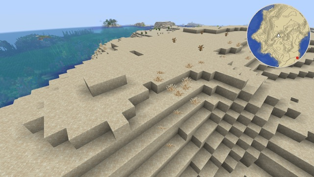

# Minimap



A round minimap in the corner of the screen, with no item and no mod: it shows the terrain from above, 64 blocks around the camera, turns with the view, remembers what was seen, and tints the seabed by the depth of the water above it. In the screenshot the camera looks south-west: north (the red dot) is behind it, and the ocean on its left is on the map's left.

## How

**1. Every block model gets a second top face, hidden inside it** ([map_faces.py](map_faces.py), run when the pack is built). It copies the face of the model's highest element, with its texture, UVs and tint, at a height inside that element that no vanilla model uses: 15.25 model pixels for a full block, 7.25 for a bottom slab, 0.75 for a carpet… These heights are free on all three axes in 26.3, and so are their opposites (16 − h), so a model turned by its blockstate still has its map face on a free value. 215 of the 346 block models that have elements get one. The others are too thin to hide a face (rails, redstone dust, lily pads, tripwires) or have no flat top (plants, which the map shows through).

**2. `terrain.vsh` draws the map faces into a capture square, instead of the world.** It recognizes them by their height, a test on `fract(Position.y)`. Their corners, from the camera's block (`Position + ChunkPosition - CameraBlockPos`), are whole numbers, so each block covers exactly one pixel of a 128 × 128 square, north up. Higher blocks win the depth test. A map face turned on its side (a log lying down) has a free value in x or z instead, and is dropped. One turned upside down faces away in this view and is culled.

**3. `terrain.fsh` colors the capture and tags it.** In the square, it discards everything but map faces, and map faces never leave it. Each block gets the average color of its sprite (`textureLod` at level 4, one texel for a 16 × 16 sprite), times the vertex color: the tint, and the ambient occlusion, which outlines every step of the terrain like contour lines. It writes alpha 0.5. The camera's own column writes the heading instead, as 24 bits, with alpha 0.25.

**4. A post effect keeps a memory of the map** (`end_of_frame`). A 256 × 257 `persistent` target holds one texel per block, at world x and z modulo 256. Each frame, the blocks that the capture shows with the 0.5 tag replace what the memory had. Other blocks keep their texel. Alpha records which 256-block region a texel belongs to, so that a texel wrapping onto another place is forgotten instead of shown. The last row keeps the last heading.

**5. The same post effect draws the map** over the capture square, which it hides: a disc of 64 blocks, 2 screen pixels per block, centered on the camera's exact position and turned so that the view points up. Blocks never seen are dark. An arrow marks the camera, a red dot north.

What it took, observed in game on OpenGL and Vulkan:

- **The first height tried, 1.5/16, is already used** by repeaters, comparators and tripwires. Hence the search for free heights on every axis ([exp 77](../../experiments/77-minimap-capture/)).
- **A face inside a block gets the sky light of the open air above it**, not the darkness of the block it is in. Under water, that light drops by one level per block of water ([exp 80](../../experiments/80-map-face-light/)). The top face of a column with less than full sky light is under water, almost always, and `15 − light` is the depth. The water itself has no model, so the map has no water surface to draw.
- **One frame only sees half the map.** The game skips the chunk sections behind the camera, so a capture alone is a cone ([exp 79](../../experiments/79-minimap-memory-control/)). The memory fills it as the camera turns ([exp 78](../../experiments/78-minimap-memory/)).
- **Only terrain needs to stay out of the capture square,** since it would win the depth test. Entities, particles, clouds or the hand that cover it don't write the 0.5 tag, and the memory keeps its texel for that frame.
- **Translucent terrain can't take part:** blending would change the tag. Map faces of ice and stained glass are discarded, and the map shows what is below. Sprites that are mostly empty, like glass, are left out the same way. Leaves stay. All three observed in a flat world, next to stone and planks.
- **After a teleport of exactly 256 blocks,** every texel of the memory wraps onto a block of the new place. The map turns dark until the chunks load, instead of showing the old place.

## Limits

- **The heading only updates while the camera's own column is captured.** Right after that teleport, before the chunks loaded, the arrow and the north dot kept the old heading. Looking straight up from the ground can probably do the same, since the section below the camera may be skipped (not checked).
- **Regions repeat every 2048 blocks:** a jump of exactly that much shows the memory of the old place.
- **The map is sized in screen pixels**, not by the GUI scale: on a 4K screen it is half as big as on a 1080p one. Status effect icons, in the top-right corner of the GUI, are drawn over it.
- **Only the Overworld makes sense.** In the Nether the map shows the bedrock roof, the topmost blocks. The End has no sky light, so its whole map should read as deep water (not checked).
- **Logs lying down, and other models turned on their side by a blockstate, are missing**: their map face is dropped, and the block below has none either, since it is covered. The map keeps what it had there, or stays dark (observed with `oak_log[axis=x]`).
- **Items show the extra face.** Block items use the block models, and the `item` program can't tell the map face apart, since its positions are already transformed. Inside opaque blocks it is hidden. Through glass or leaves it should show as a second layer under the top (not checked).
- **The memory is lost** when the pack reloads (not checked), and is kept from one world to the next unless the regions differ.

## With Sodium

Sodium draws terrain with its own shader ([Sodium](../../docs/sodium.md)), which has neither `ScreenSize` nor `CameraBlockPos`, and the capture needs both to land one pixel per block. So the example only hides the map faces there, in `block_layer_opaque.vsh`: they would otherwise show inside glass and leaves. With no capture, no heading ever arrives, and the post effect draws no map (observed). `pack.mcmeta` lists `terrain.vsh` and `terrain.fsh` under `"sodium": {"ignored_shaders"}`.

## Try it

```sh
python3 tools/examples.py minimap --out ~/Desktop
```
