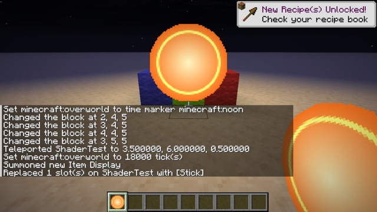

# Procedural sprite



A custom item whose look is computed by the shader, not painted in a texture: a glowing, pulsing orb, fullbright at night. The same item works in an `item_display`, in hand and in the hotbar.

```mcfunction
summon item_display ~ ~1 ~ {item:{id:"minecraft:stick",count:1,components:{"minecraft:item_model":"glow:orb"}},billboard:"center"}
give @s minecraft:stick[minecraft:item_model="glow:orb"]
```

## How

**The texture tells the shader where it is.** `glow:item/orb` is a 64 × 64 texture, generated at build time, where every texel holds its own coordinates: red = 254 (the marker), green = x, blue = y. A shader can't otherwise know where in a sprite a fragment is, because sprites are packed into an atlas at unknown positions.

**The fragment shader draws the orb** (`core/item.fsh`, at the start of `main`):

```glsl
vec4 tex = textureLod(Sampler0, texCoord0, 0.0);
if (abs(tex.r * 255.0 - 254.0) < 0.5 && tex.a > 0.99) {
    vec2 local = tex.gb * 255.0 / 63.0;            // 0..1 across the sprite
    float d = length(local - 0.5) * 2.0;           // 0 at the center, 1 at the rim
    if (d > 1.0) {
        discard;
    }
    ...                                            // core gradient + a pulsing ring, written directly to fragColor
}
```

- **The rest of the pack is a plain custom item:** `items/orb.json` points to `models/item/orb.json`, which uses the texture through `item/generated`.
- **It works in the GUI too:** GUI icons are drawn by `core/item` into the icon atlas ([Techniques](../../docs/techniques.md#isolate-an-element-of-the-gui)), so the hotbar shows the orb.
- **It handles every variant:** in the `OIT_ALPHA_ONLY` passes it only reports alpha, so it also works with Improved Transparency.
- **The edge is stepped at 1/64 of the sprite**, the resolution of the coordinate texture. Use a larger texture for a smoother edge.
- **The pulse uses a whole number of periods per `GameTime` wrap** ([Techniques](../../docs/techniques.md#animate)).

The same idea works for any procedural look: a gauge filled from a value in the tint ([exp 67](../../experiments/67-data-item-tint/)), noise, patterns, text-like displays.

## Try it

```sh
python3 tools/examples.py procedural-sprite --out ~/Desktop
```
