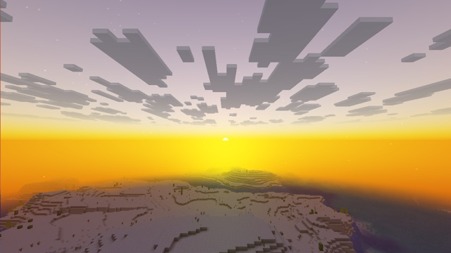

# Scattered sky



A physically based sky in a resource pack: a post effect computes the light scattered by the air, draws the sun through it, and turns the distance fog of the world toward that sky instead of the flat fog color. The moon and the stars stay vanilla.

It builds on [data-bus](../data-bus/), which brings the projection, the view rotation and the sun direction to the post effect, and adds the six fog distances of the `Fog` block and the rain brightness.

## How

**The sky** (`include/atmosphere.glsl`) is single scattering, ray-marched for each pixel through an Earth-sized atmosphere:
- Rayleigh scattering (air: the blue sky, the red sunset), Mie scattering (aerosols: the glow around the sun), ozone absorption (the deep blue of twilight), with Earth's published coefficients;
- 16 steps along the view ray, 4 toward the light;
- lit by the sun by day and by the moon by night (the opposite direction, much dimmer and bluer);
- mixed toward a grey overcast as it rains.

**Exposure and tonemapping.** A first pass renders into a 1 × 1 target. It averages the sky's luminance over 9 directions and stores the exposure, 0.28 / average, bounded so that the night stays dark, as a float in 4 bytes. The sky is then tonemapped with the ACES fit (Narkowicz 2015).

**The vanilla parts of the sky:**
- **the sky disc** carries the data bus, so it is not visible any more;
- **the sun** writes its direction onto the bus, and the post effect draws a round disc in its place;
- **the sunrise glow**, a fixed fan drawn by `core/position_color`, is moved off screen: the scattering makes its own;
- **the moon and the stars** remain. The frame is cleared to the fog color, so on a sky pixel, whatever is above the fog color is the moon or a star, added on top of the new sky.

**The fog** (`post/atmosphere.fsh`). The depth and the matrices give each pixel's position, and the bus gives the fog distances, so the post effect recomputes vanilla's fog amount exactly:

```glsl
// original = alpha * mix(surface, fogColor, fog) + (1 - alpha) * fogColor
vec3 surface = original.rgb - (1.0 - alpha) * fogColor - alpha * fog * fogColor;
float keep = (1.0 - amount) / max(1.0 - fog, 1e-4);         // amount >= fog: more haze than vanilla
color = surface * keep + alpha * amount * skyColor + (1.0 - alpha) * skyWithSun;
```

`amount` adds a haze that grows with distance (aerial perspective) and a softer fade at the edge of the loaded world. `alpha` is below 1 where a translucent surface, such as far water, has nothing behind it.

**Clouds** don't use the fog: their alpha fades with distance, and the clear color shows through. A translucent pixel above y = 190 is taken as cloud, and its `1 - alpha` part is replaced by the sky.

**Only in air.** In water, and under blindness or darkness, the fog distances differ ([Techniques](../../docs/techniques.md#reconstruct-positions-in-a-post-effect)), and the post effect leaves the image as it is. The same goes where there is no bus: the Nether, the End, lava, powder snow.

## What it took

Observed on Vulkan and OpenGL:

- **The depth range differs between backends**, so reading a position back from depth needs to know which one is in use ([Techniques](../../docs/techniques.md#reconstruct-positions-in-a-post-effect)).
- **Cutout blocks write a partial alpha far away**, where their mipmapped textures blur it. Leaves and seagrass then looked like translucent things against the sky. `terrain.fsh` and `block.fsh` write alpha 1 for cutout blocks here (`ALPHA_CUTOUT` above 0.4: translucent blocks cut out at 0.1 and keep their alpha).
- **Below y = 63, the sky program also draws a dark disc**, which would overwrite the bus. It is dropped (see [data-bus](../data-bus/)).

## Limits

- **The world itself is not relit:** at sunset, the land keeps its vanilla light.
- **Clouds keep their vanilla color.**
- **Below the horizon, the sky is the horizon color, darkened.** There is no ground or reflection model.
- **Clouds are found by height.** A pack or datapack that moves them (the `cloud_height` attribute) needs `SKY_CLOUD_BOTTOM` changed.
- **Cost:** 16 × 4 samples per pixel and per light, every frame. Fine on a recent GPU, heavy at 4K on a small one.

## Try it

```sh
python3 tools/examples.py scattered-sky --out ~/Desktop
```
