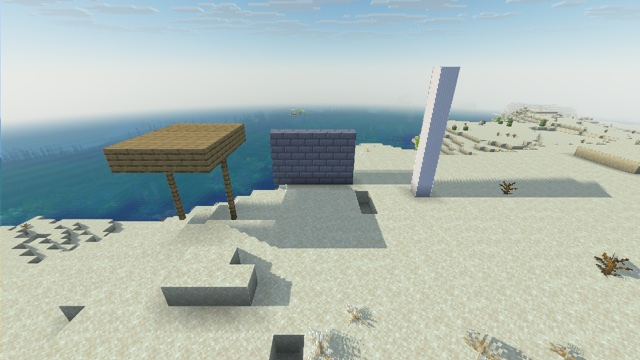

# Screen-space shadows



Shadows from the sun (and the moon at night), cast by anything on screen, in a post effect. They cut the direct light of the [sun-lighting](../sun-lighting/) relighting, which this example builds on, with [water-reflections](../water-reflections/), [scattered-sky](../scattered-sky/) and [data-bus](../data-bus/).

## How

**From each terrain pixel that faces the light, a ray is marched toward it, against the depth buffer** (`include/shadows.glsl`, called from the atmosphere pass). The pixel's position comes from its depth and the camera of the data bus. At each step, the ray's point is projected back to the screen: if the visible surface there is in front of the ray, something stands between the pixel and the light. The direct light is then cut, and only the sky's ambient light is left.

```glsl
float behind = shade_view_position(bus, uv, depth).z - position.z;   // > 0: the scene is in front of the ray
if (behind > 0.01) {
    shadow = max(shadow, 1.0 - smoothstep(0.6 * thickness, thickness, behind));
}
```

The hard part is that **the depth buffer only shows the front of things**. A ray through the back half of a block is behind the visible front by up to about 1.7 blocks, for a block seen at an angle, so the ray must count as blocked within a window behind the surface. The window and the steps had to be tuned together:

| Tried | What it did |
|---|---|
| Steps growing to 2–3 blocks, window growing with them | rays that only pass *behind* a thin pillar, as seen from the camera, counted as blocked: teeth along the shadow's edge |
| Window of one block | steps jumped over a one-block slab: a roof's shadow was only its outline |
| Window just over a block's depth | whether a ray counted as blocked depended on where its samples fell: a fine comb along the edge |
| **Steps capped at 0.3 block (96 of them), a 2.2-block window, blocking that fades over its last 40 %** | clean edges |

A per-pixel offset of the first step (interleaved gradient noise, Jimenez 2014) turns what banding remains into fine noise. Shadows fade out between 64 and 96 blocks from the camera.

## Limits

- **The first-person hand casts no shadow:** it is merged into the depth buffer with its own projection, at 1 to 2 blocks, and cast one on the ground (observed). `entity.vsh` and `item.vsh` squeeze its depth against the near plane, and the march skips it ([Techniques](../../docs/techniques.md#tell-the-hand-from-the-world-in-a-post-effect)).
- **No markers when the camera is under water:** the game's underwater overlay, drawn over the screen after the world, darkened every marker by about 5 %, and every other column of the water showed as a stripe (observed). The terrain shaders only write markers in air, which the end of the environmental fog says (96 blocks at most in water, 768 or more in air).
- **Clouds in front of water,** seen from above them, cover the markers of the even columns: such a cloud pixel takes the color of its two neighbours, or every other column of the cloud would show as a stripe (observed).
- **The marker is checked strictly:** its two bytes, alpha 1, a valid data byte, and something drawn there (depth > 0). With the two bytes alone, a uniform color filling whole columns, such as the clear color under water, matched the marker of one of the ~850 even columns about once in 77, and that column turned into a vertical stripe.
- **Only what is on screen casts a shadow,** within about 28 blocks along the ray: a tree behind the camera casts nothing, and the long shadows of a low sun end early.
- **No shadows on water** (the water pass redraws it) **nor on entities** (vanilla lighting).
- **Cost:** up to 96 depth reads per lit terrain pixel; the march stops at the first full block.

## With Sodium

The shadows only use the depth buffer and the light code that Sodium's terrain shader also writes: the example renders the same with and without Sodium ([Sodium](../../docs/sodium.md)).

## Try it

```sh
python3 tools/examples.py screen-shadows --out ~/Desktop
```
