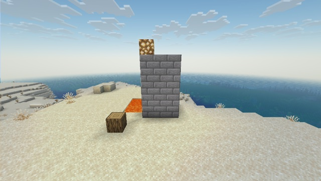

# Sun lighting



The terrain relit by the sun, the moon and the sky, in a post effect, with bloom on bright pixels and light sources. The face toward the setting sun gets warm, direct light, the others only the sky's. At night, the moon lights the land in blue, while block light (lava, torches) stays warm.

It builds on [water-reflections](../water-reflections/), [scattered-sky](../scattered-sky/) and [data-bus](../data-bus/), which provide the water, the sky, the fog and the camera.

## How

**1. Opaque terrain writes its light levels in alpha** (`include/light_code.glsl`, used by `core/terrain` and by Sodium's terrain shader). Solid and cutout terrain don't blend, so their alpha is free ([Techniques](../../docs/techniques.md#tag-pixels-for-a-post-effect)). `terrain.vsh` passes `UV2 / 240` (block and sky light, 0 to 1) to the fragment shader, which writes 8 sky levels × 6 block levels as alpha 205 to 252. The alpha of `minecraft:main` then has three ranges:

| Alpha | Pixels |
|---|---|
| 0 to 204 | translucent in front of the clear color: clouds (at most 0.8, the alpha of the cloud color `#ccffffff`), far water, glass |
| 205 to 252 | opaque terrain, with its light levels |
| 255 | anything else opaque: entities, block entities… |

**2. The post effect changes the light by a factor** (`include/lighting.glsl`). The vanilla image is albedo × light, and the albedo is unknown, so the light is replaced by a ratio:
- **vanilla's sky light** is uniform but for a fixed shade per face, from the game's code (`CardinalLighting.DEFAULT`): up 1, down 0.5, north and south 0.8, east and west 0.6;
- **the new sky light** is an ambient light, stronger on faces that see more sky, plus a direct light along the face's normal, from the sun (the moon at night). The normal comes from the derivatives of the position read from depth, snapped to the nearest axis. Surfaces that face no axis are plants (two diagonal quads, which vanilla doesn't shade) or block edges, and keep vanilla's brightness: snapping them to an axis made dead bushes glaring white in the sun;
- **normalized** so that a face pointing up keeps vanilla's brightness: day and night keep vanilla's levels, and only the direction and the color change;
- **mixed by the share of sky light** in the pixel, from the two light levels: block light is left alone.

The light colors come from the atmosphere: the sky's average color, and the sun through the air (orange at sunset). A first pass computes them once per frame, into a 4 × 1 target, and both are partly desaturated. A fully blue sky light turned the sand blue.

**3. Bloom.** Very bright pixels, and pixels that look like light sources, are averaged into a 480 × 270 target. A light source here is bright, saturated and at full block light: lava, flames, glowstone. That target is halved to 240 × 135, both are blurred along each axis (`"bilinear": true` inputs, a `BlurConfig` uniform block for the direction), and the result is screen-blended onto the image. Post-effect targets have fixed sizes, so these sizes are the same at any window size.

## Limits

- **No shadows:** a face toward the sun gets its light even if something stands in the way.
- **Entities and block entities keep vanilla lighting** (alpha 255).
- **Glass and ice in front of terrain** blend the light code with their own alpha, which then decodes to wrong levels.
- **Emissives are guessed:** a pale light source, such as a sea lantern, doesn't glow.

## With Sodium

Sodium's terrain shader writes the same light code: `_vert_tex_light_coord` holds the same levels as `UV2 / 256`. The example renders the same with and without Sodium ([Sodium](../../docs/sodium.md)).

## Try it

```sh
python3 tools/examples.py sun-lighting --out ~/Desktop
```
