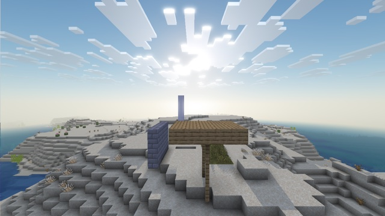

# Temporal accumulation



Three post-effect techniques, on top of [screen-shadows](../screen-shadows/), which this example builds on with [sun-lighting](../sun-lighting/), [water-reflections](../water-reflections/), [scattered-sky](../scattered-sky/) and [data-bus](../data-bus/):

- **temporal accumulation:** each frame is blended with the previous ones, reprojected, which smooths the noise of the shadows and the occlusion;
- **ambient occlusion** from the depth buffer;
- **lit clouds:** the color of the light, and a bright rim toward the sun.

The example also includes the waving plants of [waving-plants](../waving-plants/).

## Temporal accumulation

A post effect can keep data from one frame to the next in a **persistent target** (`"persistent": true`, [Post effects](../../docs/post-effects.md#targets)). Here there are two:

- **`previous_camera`**, 32 × 1: `post/camera_store` writes this frame's camera into it, as floats in 4 bytes: the projection, the view rotation, and the camera's world position (`CameraBlockPos - CameraOffset`, from `Globals`). It is the last pass but one, so the next frame reads the previous camera;
- **`history`**: the previous result.

`post/taa` then does, for each pixel:

1. **Reproject:** from the depth and this frame's camera, the pixel's world position; through the previous camera, where it was on the screen. For the sky, which is at infinity, only the rotation counts.
2. **Read the history there,** with a bilinear input.
3. **Clamp it to this frame's 3 × 3 neighbourhood:** what moved or appeared can't leave trails, because a history color outside the colors around the pixel now is pulled back in.
4. **Blend:** 12 % of this frame, 88 % of the clamped history.

A persistent target starts cleared to transparent black, so the history's alpha (written as 1) says whether it holds a frame yet. Right after the camera turns by 25°, no trail shows.

**There is no sub-pixel jitter, so no anti-aliasing of still edges.** A full TAA shifts the projection by a fraction of a pixel every frame. Core shaders have no frame counter to do it with, and Sodium's terrain shader not even `GameTime`. What it does: smooth the noise of the shadows' and the occlusion's sampling patterns, and shimmering.

## Ambient occlusion

`post/ao`: for each pixel, 12 points in a hemisphere of 1.2 blocks around its normal (from the neighbours' depth, on the side with the smaller step, which keeps block edges clean). A point counts as blocked if the depth buffer has something in front of it, not too far. The hemisphere is rotated per pixel by a 4 × 4 pattern, and `post/ao_blur` averages each 4 × 4 block, leaving out neighbours at a different depth, so the occlusion doesn't bleed across the edges of objects. The atmosphere pass multiplies opaque surfaces by it (70 %), on top of vanilla's smooth lighting, up to 64 blocks.

## Lit clouds

In the atmosphere pass, a cloud pixel is the cloud's own color times its coverage, plus the clear color showing through ([scattered-sky](../scattered-sky/)). The cloud's part is multiplied by the color of the light (warm at sunrise and sunset) and brightened toward the sun, like the forward scattering of real clouds (`include/lighting.glsl`, `temporal_cloud_light`).

## Limits

- **No anti-aliasing of still edges** (above).
- **About 20 post passes,** with ray marches for shadows and reflections and 12 occlusion samples per pixel: heavy on a small GPU.
- **The clouds keep vanilla's shapes.**

## With Sodium

Like the examples it builds on, it edits Sodium's terrain shader too, and renders the same with and without Sodium ([Sodium](../../docs/sodium.md)).

## Try it

```sh
python3 tools/examples.py temporal-accumulation --out ~/Desktop
```
