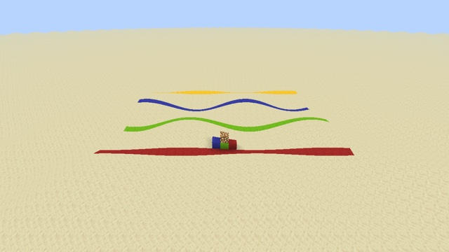

# Terrain wave



The world's chunk geometry ripples, purely in the vertex shader. Blocks still sit where they always were: only their rendering moves.

## How

`core/terrain.vsh` draws every chunk mesh: ground, water, glass, signs… (see [How a frame is drawn](../../docs/rendering.md)). The example adds three lines right after the vanilla position computation:

```glsl
vec3 pos = Position + (ChunkPosition - CameraBlockPos) + CameraOffset;   // vanilla
// World position of the vertex: its position inside the chunk section plus the section origin.
vec3 worldPos = Position + vec3(ChunkPosition);
pos.y += 1.2 * sin(worldPos.x * 0.35 + GameTime * 1200.0) * cos(worldPos.z * 0.35);
```

- **`pos` is relative to the camera.** `Position` is the vertex inside its chunk section, and `ChunkPosition` the section's origin in block coordinates. Their sum gives a world position that stays stable as the camera moves.
- **`ChunkPosition` exists in both terrain paths:** as a uniform (`ChunkSection` block) and, with `MULTIDRAW_TERRAIN`, as a vertex input. The same line works in both.
- **`GameTime`** comes from `Globals`, which `terrain.vsh` already includes.
- **Only the geometry moves.** Lighting is baked into the vertex color, so slopes are not shaded, and collisions are unchanged.

`pos` also feeds the fog distances further down, so the fog follows the displaced geometry.

## Try it

```sh
python3 tools/examples.py terrain-wave --out ~/Desktop   # builds ~/Desktop/terrain-wave, a resource pack folder
```

The pack is built from your installed 26.3: vanilla `terrain.vsh` plus the edit in [example.json](example.json).
