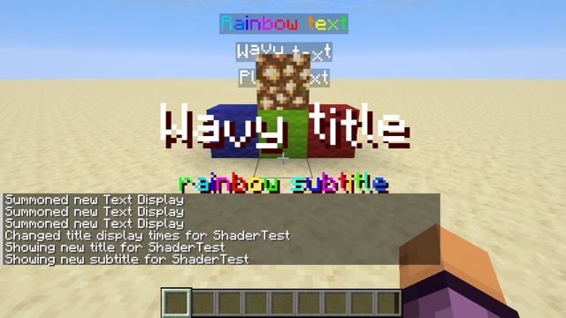

# Text effects



Commands or a datapack pick an effect just by the color of a text: `#FE0101` is a scrolling rainbow, `#FE0102` a wave. Any other color stays plain. It works for every text: `text_display`, `/title`, chat, signs, name tags.

```mcfunction
title @a title {text:"Wavy title",color:"#FE0102"}
summon text_display ~ ~1 ~ {text:{text:"Rainbow text",color:"#FE0101"},billboard:"center"}
```

## How

`core/text.vsh` receives the text color, unchanged, in the `Color` vertex input ([exp 66](../../experiments/66-data-text-color/)). The example compares it with the two marker colors, right after the vanilla code:

```glsl
// gl_VertexIndex / 4 is the glyph's index in the text: the effect works in the world and in the GUI alike.
float glyph = float(gl_VertexIndex / 4);
vec3 rgb = Color.rgb * 255.0;
if (all(lessThan(abs(rgb - vec3(254.0, 1.0, 1.0)), vec3(0.5)))) {
    // #FE0101: rainbow
    float hue = fract(glyph * 0.08 - GameTime * 800.0);
    vec3 rainbow = clamp(abs(fract(hue + vec3(0.0, 2.0 / 3.0, 1.0 / 3.0)) * 6.0 - 3.0) - 1.0, 0.0, 1.0);
    vertexColor = vec4(rainbow, Color.a);
} else if (all(lessThan(abs(rgb - vec3(254.0, 1.0, 2.0)), vec3(0.5)))) {
    // #FE0102: wave, in clip space so the height is the same at any distance and in the GUI.
    gl_Position.y += sin(glyph * 0.9 + GameTime * 6.2831853 * 2400.0) * 0.025 * gl_Position.w;
    vertexColor = vec4(1.0, 1.0, 1.0, Color.a);
}
```

- **The glyph index comes from `gl_VertexIndex / 4`**, because each glyph is a quad of 4 vertices. It doesn't depend on where the text is or how large, so the same code works for world text and GUI text.
- **The wave is applied in clip space** (`gl_Position`, scaled by `w`), so it has the same height on screen whatever the distance.
- **`GameTime` needs `#include <minecraft:globals.glsl>`.** `Globals` is available to every `core/text` pipeline ([core-shaders.md](../../docs/reference/core-shaders.md)). The speeds use a whole number of periods per `GameTime` wrap, so the animation never jumps ([Techniques](../../docs/techniques.md#animate)).
- **Marked text is drawn fullbright:** `vertexColor` is replaced, so the lightmap no longer darkens it at night.
- **Shadows are not affected.** A text shadow is drawn in a darker copy of the color, which no longer matches the marker. In the title above, the shadow stays still under the waving letters. To include shadows, also match the darkened marker color.

## Try it

```sh
python3 tools/examples.py text-effects --out ~/Desktop
```
