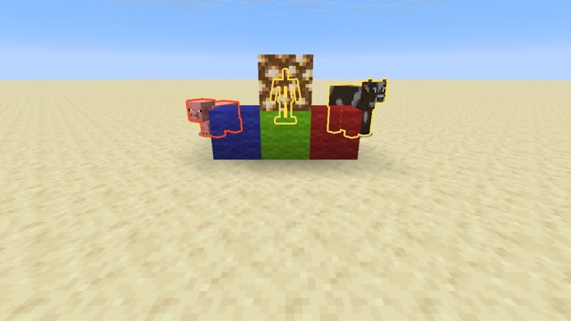

# Thick outlines



Glowing entities get a thick, crisp, tinted outline instead of vanilla's thin blurred one. The pack only replaces one post effect, `minecraft:entity_outline`.

## How glowing outlines work

*(code, see [How a frame is drawn](../../docs/rendering.md))*
1. **Silhouettes:** entities with Glowing are drawn as silhouettes into the `minecraft:entity_outline` target, with their team color in RGB and their coverage in alpha.
2. **Outline post effect:** `minecraft:entity_outline` turns those silhouettes into an outline, in place. Vanilla uses an edge detection and two blur passes.
3. **Composite:** the game draws the target onto the world by its alpha, with `core/blit_screen`.

`minecraft:entity_outline` is the only post effect allowed to read and write the `minecraft:entity_outline` target. Others are refused ([exp 53](../../experiments/53-entity-outline-target/)).

## This example

[`entity_outline.json`](example.json) runs two passes:

| Pass | Reads | Writes | Does |
|---|---|---|---|
| `outline:post/dilate` | `minecraft:entity_outline` | `swap` | outside a silhouette, takes the color of the nearest silhouette pixel within `Radius` (a disc), tinted by `Tint` |
| `outline:post/copy` | `swap` | `minecraft:entity_outline` | copies back, **keeping alpha**, since the composite uses it |

- **Team colors still work**, because the outline takes the silhouette's color: the outline is the team color times `Tint`. In the screenshot, the pig is in a red team (`/team modify red color red`).
- **`Radius` is in pixels**, so the outline keeps the same thickness at any distance. It costs about `Radius²` texture reads per pixel near outlines.
- **The vertex shader is the pack's own** (`outline:post/fullscreen`, see [Post effects](../../docs/post-effects.md#the-vertex-shader)).

## Try it

```sh
python3 tools/examples.py thick-outlines --out ~/Desktop
```
