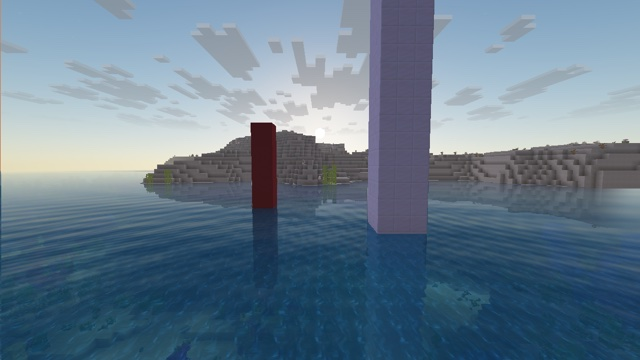

# Water reflections



Water with waves, reflections, refraction and Fresnel, drawn by a post effect. The terrain shaders mark the water, and the post effect redraws it. It builds on [scattered-sky](../scattered-sky/), which provides the sky and the fog, and on [data-bus](../data-bus/), which provides the camera.

## How

**1. The terrain shaders mark the water** (`include/water.glsl`, used by `core/terrain` and by Sodium's terrain shader).
- **Recognizing water:** water textures (`water_still`, `water_flow`, `water_overlay`) have a uniform alpha of 180/255. The slime block shares it, but water is tinted by the biome and slime is white. `terrain.vsh` passes the raw vertex color (`Color`, the tint) to the fragment shader for this.
- **The marker:** on even screen columns, a water fragment writes a marker instead of its color, with alpha 1. Translucent blending (`SRC_ALPHA, ONE_MINUS_SRC_ALPHA`) then keeps it exact. The marker is two bytes that depend on the column, so a scene color matches by chance with a probability of 1 in 65536. A third byte says whether the surface is horizontal, from the derivatives of the position.
- **The odd columns** keep the vanilla water, blended over what is underneath: they carry the refraction.

```glsl
// terrain.fsh, before the color is computed
if ((int(gl_FragCoord.x) & 1) == 0 && sea_is_water(textureColor, seaTint)) {
    fragColor = sea_water_marker(int(gl_FragCoord.x), waterData);
    return;
}
```

**2. The atmosphere pass reads the markers.** A marker pixel takes the vanilla water of its neighbours. Both columns are tagged as water in the alpha of the pass's output (0.5 for a horizontal surface, 0.25 for a side). The fog is then applied as for every other pixel.

**3. The water pass redraws the tagged pixels** (`post/water.fsh`). Translucent terrain writes its depth, so the depth buffer holds the water surface.
- **Waves:** eight directional waves give the slope of the surface at each point; the geometry stays flat. Their frequencies are whole numbers of periods per 1200 s, the period of `GameTime` ([Techniques](../../docs/techniques.md#animate)). Two things had to be fixed:
  - **rings around the camera:** a wave shorter than a pixel, sampled once per pixel, turns into moiré. Each wave fades out when it gets shorter than a few pixels on the surface, where a pixel measures its angular size × the distance, stretched by the grazing angle;
  - **repetition:** pure sines are periodic, and the far sea showed regular parallel bands. A slow noise bends the wave fronts and varies each wave's amplitude from place to place. It depends on the position only, so nothing jumps when `GameTime` wraps.
- **Reflection:** a ray marched in view space against the depth buffer (40 steps, then 5 to refine), faded near the screen edges. It follows the reflection of the *flat* surface, and the waves only shift where the mirrored color is read: following the waves' own reflection, a grazing ray hit the island or missed it depending on the slightest tilt, and the sea stopped mirroring the land. Where the ray leaves the screen, it falls back to the scattered sky in the waves' reflected direction, with the sun's disc and a glint. The waves also tilt less the flatter the view and the farther away.
- **Refraction:** the vanilla water, shifted by the waves and darkened toward blue-green at grazing angles. The darkening spares the part of the color that is already fog: otherwise the far sea ends in a dark edge against the sky.
- **Fresnel** (Schlick, F0 = 0.02) mixes the two, and the reflection gets the same distance fog as the rest. It sees only a quarter of the waves' tilt: at a grazing angle it swings from 0.8 to 0.3 with a slight tilt, and with the full waves, the reflection gave way to the water's blue.

## Limits

- **Only what is on screen can be reflected.** Elsewhere, the reflection falls back to the sky. The moon and the stars are not reflected either: they are sky pixels, which the ray never hits.
- **Refraction is half resolution horizontally**: the marker columns carry no image.
- **The depth of the water is unknown**, so shallow and deep water look alike.
- **No geometric waves**: under Sodium, the terrain shader has no game time to move vertices with.
- **Nothing changes from underwater**, where the post effects do nothing.
- **Improved Transparency** draws water through other passes, which don't write markers (not tested).

## With Sodium

The same markers are written by Sodium's terrain shader (`assets/sodium/shaders/blocks/block_layer_opaque.*`), and the example renders the same with and without Sodium ([Sodium](../../docs/sodium.md)).

## Try it

```sh
python3 tools/examples.py water-reflections --out ~/Desktop
```
