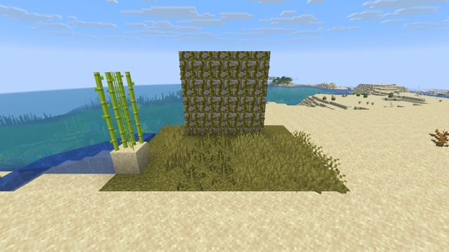

# Waving plants



Grass, ferns, tall grass, sugar cane and vines sway in the wind, while the ground stays still. Only the vertex shader of the terrain changes: `core/terrain.vsh`, and the same in Sodium's terrain shader.

## How

**1. Recognize plants from what a vertex shader has** (`include/wind.glsl`). `terrain.vsh` doesn't know which block it draws, so a plant is a vertex that is:
- **in the cutout layer** (`ALPHA_CUTOUT` 0.5; translucent terrain cuts out at 0.1);
- **tinted by the biome**: its `Color` is not grey. That leaves out torches, rails and glass;
- **off the block grid** in x or z: cross models are inset by a pixel, vines stand off their wall, and short grass gets a random offset. The grass block is also tinted and cutout, but its vertices are on the grid: without this test, the ground would move and crack.

**2. Sway the whole plant.** A vertex can't tell the top of its plant from its base:
- **`gl_VertexIndex % 4` is not stable.** Coloring plant vertices by it gave different corners from one run to the next, and other ones on OpenGL;
- **`UV0` lies on the corners of the sprite**, which the neighbouring sprites in the atlas share;
- **both ends of a plant are at whole block heights.**

So the whole plant moves, by a few hundredths of a block, and the phase of the wind changes with height: the top and the base don't move together, and the plant bends more than it slides. Every frequency is a whole number of cycles per `GameTime` wrap ([Techniques](../../docs/techniques.md#animate)).

```glsl
// terrain.vsh, after pos is computed
vec3 world = Position + vec3(ChunkPosition);
if (ALPHA_CUTOUT > 0.4 && plants_is_plant(world, Color)) {
    pos.xz += plants_wind(world, GameTime);
}
```

Measured between two screenshots 2 s apart, on both backends: 11 % of the grass pixels and 14 % of the sugar cane change, and none of the ground.

## With Sodium

Sodium's terrain shader has no `GameTime`, but `u_CurrentTime`, the milliseconds since its region (128 × 64 × 128 blocks) was created. `float(u_CurrentTime % 1200000) / 1200000.0` is a clock that wraps every 1200 s like `GameTime`, so the same frequencies work. Each region starts its clock at a different moment, which only shifts the wind's phase there: a plant never crosses a region's border, so it doesn't show. A pattern that spans the world would tear at the borders ([exp 82](../../experiments/82-sodium-region-clock-late/)).

Sodium's positions are relative to the camera, so the wind and the grid test use the position inside the region, whose origin is on the world grid. Measured with Sodium 0.9.2 alone, and with Sodium Extra 0.9.4 and 0.9.5, on both backends: 15 to 18 % of the plant pixels change, none of the ground ([Sodium](../../docs/sodium.md)).

## Limits

- **Only tinted plants wave:** flowers, crops, dead bushes and saplings stay still. Leaves too: they are full cubes on the grid, and moving them would open gaps.
- **The base slides a little** with the rest of the plant.

## Try it

```sh
python3 tools/examples.py waving-plants --out ~/Desktop
```
