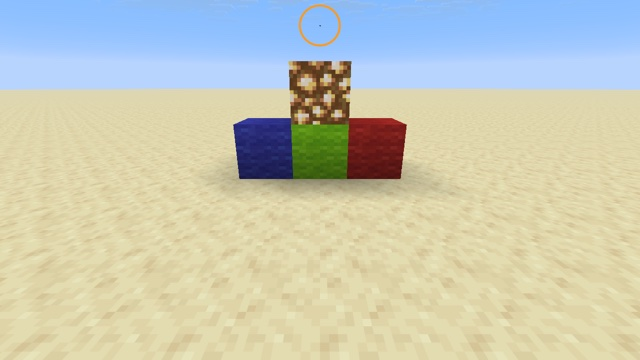

# World anchor



A post effect draws a ring around a point in the world. The point is an `item_display` placed by a command or a datapack. The anchor sends its screen position to the post effect through **control pixels**.

```mcfunction
summon item_display ~ ~2 ~ {item:{id:"minecraft:leather_horse_armor",count:1,components:{"minecraft:dyed_color":16646402}},billboard:"center",transformation:{scale:[0.05f,0.05f,0.05f],translation:[0f,0f,0f],left_rotation:[0f,0f,0f,1f],right_rotation:[0f,0f,0f,1f]}}
```

## How

1. **Recognize the anchor** (`item.vsh`): the item is tinted exactly `#FE0102`, which reaches `Color` unchanged ([exp 67](../../experiments/67-data-item-tint/)).
2. **Encode its position**: the vertex's screen position, 0 to 1 per axis, goes into two bytes per axis, in a `flat` varying.
3. **Move it onto control pixels**: the vertex is moved onto a 3 × 1 pixel strip in the corner at NDC (-1, -1), in front of everything (NDC z = 0.999: depth is reversed, so near is 1).
4. **Write the data** (`item.fsh`): on that strip, pixel 0 gets a marker color (magenta), pixel 1 the x bytes, and pixel 2 the y bytes, all with alpha 1 so blending can't alter them.
5. **Read it in a post effect** (`end_of_frame`): find the marker, decode the position, draw the ring, and paint over the strip with the row next to it.

What these steps taught, on both backends:
- **NDC (-1, -1) is the bottom-left corner of the screen**, on OpenGL and Vulkan alike.
- **The moved quad must stay front-facing:** the item pipelines cull back faces. With the corners in the order (0, 0), (1, 0), (1, 1), (0, 1) by `gl_VertexIndex % 4`, the strip is drawn. In the reverse order, it disappears.
- **A `flat` varying takes its value from a different vertex on each backend**, so with a large anchor, the ring lands on a different corner of the item on OpenGL and on Vulkan. A tiny anchor (scale 0.05) makes the corners coincide, and keeps it nearly invisible.
- **Only the tinted layer becomes the anchor.** An untinted layer of the item model would still be drawn in place.

The post effect looks for the strip in both the bottom and the top row of `minecraft:main`, and flips `y` if it is in the top row, so it doesn't depend on how the target is stored.

## Going further

The same channel carries any value a vertex shader can compute: a distance, a direction, or a datapack value read from the tint, with 24 bits per pixel. Several anchors need several strips, for example at different x offsets chosen by the tint.

## Try it

```sh
python3 tools/examples.py world-anchor --out ~/Desktop
```
